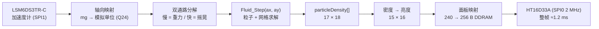
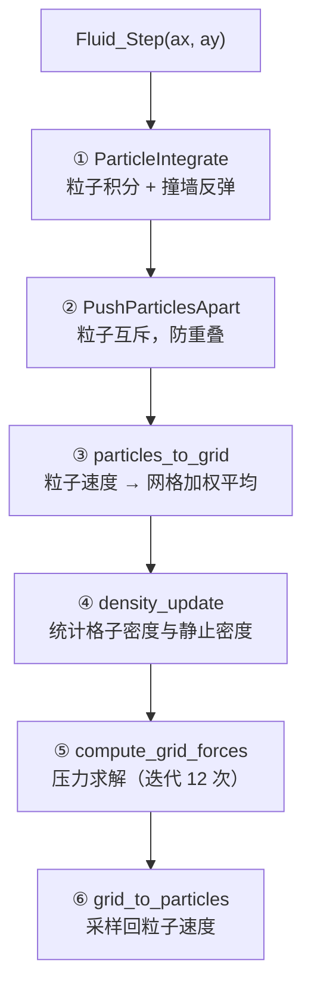

an'jian

# MSPM0G3507 流体模拟

在 LP-MSPM0G3507 上运行的**实时二维流体模拟**。
把板子倾斜，板载加速度计测出重力方向，流体就顺着重力流向低位，最后静止下来。

算法移植自 CH32V203 上的 Charlieplex LED 点阵项目 `FLIP_LED`，
显示层和定点数学层在本工程中全部重写。

| 项目             | 内容                                                                             |
| ---------------- | -------------------------------------------------------------------------------- |
| 主控             | MSPM0G3507（Cortex-M0+ @ 80 MHz，**无 FPU**；128 KB Flash / 32 KB SRAM）   |
| 封装             | **LQFP-48 (PT)**，订货型号 MSPM0G3507SPTR                                    |
| 显示             | **HT16D33A 16×16 LED 点阵**（SPI0：CLK/DIO/CSB 三线，2 MHz，灰度 256 级）|
| 输入             | **LSM6DS3TR-C**（WHO_AM_I=0x6A，SPI1）；驱动重力 + 摇晃（IMU 不通时自动退回假重力） |
| 算法             | FLIP/PIC 混合流体 + MAC 网格压力投影（Q24 定点 + MATHACL 硬件除法）              |
| 单帧耗时         | 物理 ≈20.3 ms + 推屏 ≈1.2 ms ≈ **21.5 ms/帧**                            |
| 实测占用         | Flash **22.4 KB** / 128 KB，SRAM **22.3 KB** / 32 KB                     |

## 显示布局

面板是 **16 列 × 15 行（240 颗）**，流体网格是 **15 列 × 16 行**，两者是**转置关系**，
由 `led_matrix.h` 的 `LED_ORIENT_SWAP_XY / FLIP_X / FLIP_Y` 处理
（方向和机械安装有关，看综合演示的图案段调）。

灰度模式下每格是 **1 字节亮度（0~255）**，不是简单的亮/灭：液体内核亮、表层暗，
所以液面看起来是柔的。想退回二值显示，把 `ht16d33a.h` 的
`HT16D33A_USE_BINARY_MODE` 置 1（`fluid_demo.c` 里保留了一整套阈值 + 滞回实现）。

## 数据流



整条链路是**单线程超级循环**：`main()` 初始化完成后进入 `FluidDemo_Run()` 的
`for(;;)`，中间只靠一个 SysTick 中断（每 1 ms 给 `tick_ms++`）提供时间基准，
另有一个 TIMA0 的 5 ms 中断跑按键扫描与一键开关机。
LED 点阵和 SPI 都是轮询（阻塞）访问，没有任何“等中断”环节。

## 流体算法

### 为什么用 FLIP/PIC 混合

纯粒子法（SPH）在 170 个粒子这种极稀疏的规模下会散成一团；纯网格法（欧拉）
会把流体抹糊。这里用的是**混合**方案：

- **粒子**负责对流：每个粒子独立运动，液面不会糊
- **网格**负责不可压缩：压力求解保证速度场无散度，液体才有“水”的感觉
- 每步结束时把网格速度按比例**混合回**粒子（FLIP/PIC 的区别就在这个比例）

### 一个时间步的六个阶段



各阶段在 80 MHz 下的实测耗时（**MATHACL 优化之前**的基线）：

| 阶段                      | 作用                  | 耗时              | 含`_IQdiv` |
| ------------------------- | --------------------- | ----------------- | ------------ |
| ①`ParticleIntegrate`   | 粒子积分 + 撞墙       | 0.25 ms           | —           |
| ②`PushParticlesApart`  | 粒子互斥（1 次迭代）  | 8.2 ms            | ✓           |
| ③`particles_to_grid`   | 粒子 → 网格          | 4.4 ms            | ✓           |
| ④`density_update`      | 密度统计              | 0.6 ms            | ✓           |
| ⑤`compute_grid_forces` | 压力求解（12 次迭代） | 6.5 ms            | —           |
| ⑥`grid_to_particles`   | 网格 → 粒子          | 8.0 ms            | ✓           |
|                           | **合计**        | **28.2 ms** |              |

> 换成 MATHACL 硬件除法后**总耗时降到约 20.3 ms**（省 7.9 ms，−28%）。
> 按上表“含 `_IQdiv`”那一列判断，省下来的时间落在 ②③⑥ 三个阶段。
> 当前 HUD 只显示总耗时 `SIM`，想看分阶段需要把计时代码加回去。

### 网格与粒子参数

| 参数            | 值                                                        | 位置             |
| --------------- | --------------------------------------------------------- | ---------------- |
| 网格            | 17 × 18（外圈为 SOLID 边界，内部可视 15 × 16 = 240 格） | `fluid.h`      |
| 粒子数          | 170                                                       | `fluid.h`      |
| 粒子半径 / 间距 | 0.017 / 0.05                                              | `fluid.h`      |
| 时间步长`dt`  | 0.032 s                                                   | `fluid_demo.c` |
| 压力迭代次数    | 12                                                        | `fluid_demo.c` |
| 撞墙弹性        | -0.9                                                      | `fluid.h`      |

> `dt = 0.032` 而一帧（物理 ≈20.3 ms + 推屏 ≈1.2 ms）只要 21.5 ms，
> 所以仿真速度是实时的 **1.49 倍** —— 看起来比现实快一点。
> 想要正好等于实时，把 `dt` 改成约 **0.0215**。
> `dt` 只出现在 `ParticleIntegrate` 的 4 次乘法里，所以改变它对总耗时的
> 影响几乎为零（压力投影是在速度场上做的，与 `dt` 无关）。

## 定点数学：为什么要自己写

原 CH32 工程用的是 WCH 的 `libIQMath_RV32.a`（Q24 定点库），但那是
**RISC-V 预编译二进制，在 ARM 上无法链接**。所以 `hardware/fluid_iqmath.h`
按相同的 Q24 语义重写了一份，只依赖标准库：

| 宏              | 实现                                                                 |
| --------------- | -------------------------------------------------------------------- |
| `_IQ(x)`      | 编译期把浮点常量折成 Q24，不产生运行时代码                           |
| `_IQmpy(a,b)` | 内联的 4 次 16×16→64 位乘法，避免调用库函数`__aeabi_lmul`        |
| `_IQdiv(a,b)` | **MATHACL 硬件除法器**（写 4 个寄存器，约 10~20 周期；见下文） |
| `_IQsqrt(a)`  | 32 次逐位 shift-add（也可以换 MATHACL，但全工程只用了 1 次，未换）   |

Cortex-M0+ 没有 FPU，也没有单指令 32×32 乘法，所以 Q24 乘法的开销必须认真
对待 —— 详见下一节。

## 性能优化

物理计算侧一共做了三步，每步都有实测数据支撑（80 MHz、`-O2`）：

| # | 改动 | 效果 | 依据 |
| - | --- | --- | --- |
| 1 | 热点函数搬进 SRAM（`.TI.ramfunc`）+ 乘法内联 | 50.7 ms → 31.6 ms（1.60×）| 含除法的阶段提升小、不含的提升大（INT 2.5×、DEN 3.2×）|
| 2 | `_IQdiv` 从 64 位整数除法改为软浮点除法 | 31.6 ms → 28.2 ms（−11%）| INT/DEN/PRS 不含除法，耗时不变；SEP/TOG/FRG 掉了 10~20% |
| 3 | `_IQdiv` 改用 **MATHACL 硬件除法器** | 28.2 ms → **≈20.3 ms**（−28%）| 单次除法从 ~700 周期降到 ~20 周期 |

合计：**50.7 ms → 20.3 ms（2.5 倍）**。

> 显示侧当年还有两步（OLED 逐字节推屏 → 分页事务 → I2C 1 MHz），
> 把一帧从 42.4 ms 压到 26.3 ms。那套代码已经随 OLED 一起删除，
> 现在的 LED 点阵整帧只要 1.2 ms —— 但**思路是一样的：
> 先把推屏从"逐字节"改成"整块"**。
关键教训：**优化前先测**。一开始我以为瓶颈在压力求解（迭代 12 次听起来很贵），
但实测四个迭代次数（12/8/4/1）的耗时符合 `SIM ≈ 406 + 8.6 × GI`，
说明压力求解只占约 10 ms（4%），固定开销占了 96%。

另一条教训：**用“改动前后的差值”定位瓶颈，比读汇编数指令可靠**。
第 3、4 两步都是只换除法实现，通过对比“含除法 / 不含除法”两类阶段的
耗时变化，就能反推出除法到底占了多长时间。

## 硬件加速：MATHACL

MSPM0G3507 内置 **MATHACL 数学加速器**（TI 官方描述为 “Trigonometric math
accelerator”），提供定点除法、开方、sin/cos、四象限反正切、乘加等运算。
本工程用它替换了 Q24 除法。

**开启方式（三步，不需要配任何参数）**：

1. `gpio_toggle_output.syscfg` 里加模块：

   ```javascript
   const MATHACL = scripting.addModule("/ti/driverlib/MATHACL");
   ```
2. SysConfig 生成的 `SYSCFG_DL_init()` 里会出现两行 —— **少了第二行会静默失效**
   （寄存器写得进，但结果永远是 0，很难查）：

   ```c
   DL_MathACL_reset(MATHACL);
   DL_MathACL_enablePower(MATHACL);
   ```
3. 直接读写寄存器。调用序列**必须**按这个顺序：

   ```c
   MATHACL->CTL = 操作码 | (Q格式 << 8) | (1 << 5);  /* bit5 = 立即触发 */
   MATHACL->OP2 = 第二个操作数;
   MATHACL->OP1 = 第一个操作数;   /* 写 OP1 就是发令，必须最后写 */
   结果 = MATHACL->RES1;          /* 读 RES1 时硬件会 hold 总线直到算完 */
   ```

**没有轮询循环、没有中断**：写 `OP1` 触发，读 `RES1` 取结果，靠 AHB 等待自动同步。

本工程用到的操作码（Q24 时的 CTL 值）：

| 操作 | 操作码 | CTL                                   |
| ---- | ------ | ------------------------------------- |
| DIV  | 4      | `0x1824` = `4 \| (24<<8) \| (1<<5)` |

验证方法：用 `tiarmclang -S` 输出汇编，常量池里应该能看到 `.long 6180`（即
`0x1824`）和 `_IQdiv` 的 4 条寄存器访问。

**`_IQmpy` 故意没换**。FOC 工程用 `-D_IQ_MPY_MATHACL_INLINE` 把乘法也交给
MATHACL，那是因为它用 **IQ27**：32×32 乘法要 64 位中间结果 → 汇编里是
`__aeabi_lmul`（约 30~60 周期 + 函数调用）。而本工程的 **Q24 乘法已经内联成
4 次 16×16 乘法**（约 30 周期、无调用），再换成 MATHACL 要付出 4 次外设总线
访问，收益存疑甚至可能变慢。

> ⚠️ **MATHACL 不可重入** —— 只有一组 `CTL/OP1/OP2/RES1`。目前只有主循环用它，
> 安全；以后如果中断里也要用，必须加互斥。

## 调试观测（dbg）

OLED 已删除，所有观测量都走 `hardware/debug.h` 的全局 `dbg` 结构体 ——
没有屏，参数只能这样看：在 CCS 的 Expressions 里展开 `dbg`，或把它加进 Watch 窗口。

| 字段 | 含义 |
| --- | --- |
| `dbg.fluid.ax10` / `ay10` | **实际送入流体算法**的值（模拟单位 ×10）。正着放时应为 `(0, +98)` |
| `dbg.fluid.ax_slow10` / `ay_slow10` | 慢通路（重力 / 倾角）分量 |
| `dbg.fluid.ax_fast10` / `ay_fast10` | 快通路（摇晃 / 惯性）分量，已含增益 |
| `dbg.fluid.shake_pk10` | 窗口内摇晃峰值（静止 ≈0，摇起来几百）|
| `dbg.fluid.sim_ms_x10` | 单步物理平均耗时 ×10（`203` = 20.3 ms）|
| `dbg.fluid.fps` / `frames` | 帧率 / 累计物理步数 |
| `dbg.fluid.dens_max` / `rest_dens` | 窗口内最大密度 ×1000 / 静止密度。**`rest_dens` 变负就是 int32 溢出**，见 `fluid.h` 里 `NumberOfParticles` 的注释 |
| `dbg.fluid.imu_ok` / `imu_use` | IMU 初始化返回码 / 本帧是否真的用了 IMU |
| `dbg.bat.mv` / `low_cnt` / `err` | 电池电压(mV) / 连续低电次数 / 转换超时次数 |
| `dbg.key.*` / `dbg.pwr.*` | 三路按键状态 / 一键开关机状态机 |

## 显示刷新

每个时间步把 `particleDensity[]` 按密度映射成亮度写进 `s_frame[256]`（DDRAM 顺序），
然后一次整帧推送：

| 项目 | 值 |
| --- | --- |
| 数据量 | 256 字节（16 列 × 15 行，每点 1 字节亮度）|
| 接口 | SPI0 @ 2 MHz，`HT16D33A_WriteRam()` 分 8 个 burst |
| 整帧耗时 | **≈1.2 ms**（21.5 ms 一帧里的 5.6%）|

> 二值模式下 DDRAM 只有 32 字节（1 bit/点），推屏更快，但液面会变成硬边。

## 串口调试（115200，PB6/PB7）

调试走串口，**收发都用 DMA，不用任何中断**（移植自 `MSPM0G3507_DRV8316` 工程）：

| 方向 | 通道 | 实现 |
| --- | --- | --- |
| 下行命令 | UART1 RX → **DMA_CH0** | `hardware/vcmd.c`：定长 128 B 缓冲 + 主循环轮询 |
| 上行遥测 | **DMA_CH1** → UART1 TX | `hardware/vofa.c`：FireWater 文本帧，忙就丢帧 |

接线：PB6 = TX，PB7 = RX，**115200** 8N1（CH340N 转 USB）。命令**不回显、不应答**。

### 命令表

一行一条，`\n` 或 `\r` 结尾；空格 / `=` / `,` 都当分隔符。

| 命令 | 参数 | 作用 |
| --- | --- | --- |
| `div <0-7>` | 0 = 关 | 遥测分频，每 2^n 帧发一帧（默认 **0 = 关**）|
| `mask <0-255>` | bit0~7 | 通道掩码（默认 15 = sim/fps/ax/ay）|
| `reset` | — | 清零 `dbg.uart` 统计 |
| `dt <n>` | n = dt×1e5 | 时间步长，`3200` = 0.032 s |
| `iter <0-32>` | | 压力迭代次数 |
| `shake <n>` | n = 增益×100 | 摇晃增益，`150` = 1.5 |
| `pause <0/1>` | | 冻结物理（画面照常刷新）|
| `reinit` | — | 粒子归位 |
| `bc <0-255>` | | 全局亮度 `0x37` |
| `cc <0-15>` | | 恒流档 `0x36`（7 = 24 mA）|
| `fill <0-255>` | | 整屏填充指定亮度（自动冻结渲染）|
| `off` | — | 全灭（自动冻结渲染）|
| `px <x> <y> <lv>` | x 1~15, y 1~16 | 单点（自动冻结渲染）|
| `ramp` | — | 画 14 级**线性**亮度阶梯（自动冻结渲染，标定用）|
| `rampg` | — | 画 14 级 **gamma2.2** 阶梯（观感验收用）|
| `lock <0/1>` | | 冻结 / 恢复流体渲染 |
| `gam <0/1>` | | 流体渲染走 gamma2.2 表（默认 **0 = 线性**，行为不变）|
| `full <20-300>` | | 满亮度密度 = 静止密度 × n/100（默认 **60**）|
| `edge <pct> <gain>` | pct < full | 边缘分段映射（"抗锯齿"），`edge 0` 关闭 |

也支持纯命令号形式，给上位机滑块用：`513 200` 等价于 `bc 200`（命令号见 `debug.h` 的 `DBG_CMD_*`）。

### 亮度标定怎么用

```
lock 1          # 冻结流体，画面静止
ramp            # 画 14 级阶梯，每行一个已知 DDRAM 值
cc 7            # 固定恒流 24 mA
bc 255          # 固定全局亮度
                # → 探头逐行读，得到 DDRAM → 光输出曲线
bc 128          # 改全局亮度再读一轮，验证 0x37 的线性度
lock 0          # 恢复流体
```

⚠️ `bc` 设的值会被记住（`s_userBc`），低电安静窗口熄屏采样后恢复的是它，不会打回 255。

### 线性 vs gamma：两条阶梯命令的区别

`ramp` 和 `rampg` 画的内容完全一样，只有亮度取值不同：

| 级 | 1 | 2 | 3 | 4 | 5 | 6 | 7 | 8 | 9 | 10 | 11 | 12 | 13 | 14 |
|---|---|---|---|---|---|---|---|---|---|---|---|---|---|---|
| `ramp` 线性 | 0 | 19 | 39 | 58 | 78 | 98 | 117 | 137 | 156 | 176 | 196 | 215 | 235 | 255 |
| `rampg` gamma | 0 | 1 | 4 | 10 | 19 | 31 | 47 | 65 | 88 | 114 | 143 | 177 | 214 | 255 |
| 线性·感知 | 0.00 | 0.31 | 0.43 | 0.51 | 0.58 | 0.65 | 0.70 | 0.75 | 0.80 | 0.84 | 0.89 | 0.93 | 0.96 | 1.00 |
| gamma·感知 | 0.00 | 0.08 | 0.15 | 0.23 | 0.31 | 0.38 | 0.46 | 0.54 | 0.62 | 0.69 | 0.77 | 0.85 | 0.92 | 1.00 |

**实测结论（2026-10-23）**：`ramp` 用手机传感器拍是**均匀梯度**（硬件线性没问题），
但肉眼看到第 7 级往后几乎没有变化 —— 因为人眼感知 ≈ `亮度^0.45`，
线性台阶的前 6 级就吃掉了 75% 的感知变化。`rampg` 的感知列是等距的（每级 +0.077）。

所以：
- **测硬件**用 `ramp`（要的就是物理线性）
- **验观感**用 `rampg`
- 以后给自定义画面做 gamma 表，按 `rampg` 的取值为基准

### 让液体更有层次：`gam` 和 `full` 是两个不同的旋钮

液体内核糊成一片白，**主要不是 gamma 的问题**，是满量程定得太低：

```c
#define FLUID_DENS_FULL_PCT  60    /* 密度超过静止密度的 60% 就截断到 255 */
```

液体内部密度普遍在这个范围以上，所以整片都被截到 255。gamma 对 255 查表
还是 255，救不了。

| 命令 | 作用 | 副作用 |
|---|---|---|
| `full 60` → `full 100` | 只有最密的内核才到 255，层次拉出来 | 整体变暗 |
| `gam 1` | 中间调压暗，表层到内核的过渡更明显 | 整体变暗，暗部细节减少 |

两个一起调才有效果。建议顺序：先 `full` 找到"内核刚好不满"的点，再开 `gam 1`
修中间调。默认都是关的，所以不改也能保持原来的观感。

### 边缘处理（`edge`）—— 15×16 网格上的"抗锯齿"

一个 LED 就是最小像素，**真正的抗锯齿不存在**。能做的只有把边缘那段密度
单独拉开，让边界不是"突然出现的一格"。

```
d < dEdge:      边缘段，斜率单独设
dEdge ≤ d < dKnee:  接到 255（两段在 dEdge 处连续，没有台阶）
d ≥ dKnee:      内核，不动
```

设 `t = 密度 / 满量程密度`（0~1），`pct` = 边缘段占满量程的百分比：

| t | 线性 | `edge 15 50` | `edge 30 15` | `edge 15 15` |
|---|---|---|---|---|
| 0.05 | 13 | **43** | **6** | 13 |
| 0.15 | 38 | **128** | **19** | 38 |
| 0.30 | 76 | 150 | 38 | 76 |
| 0.60 | 153 | 195 | 131 | 153 |
| 1.00 | 255 | 255 | 255 | 255 |

⚠️ **方向由 `gain` 和 `pct` 的相对大小决定**，不是单独看 `gain`：

- `gain > pct` → 边缘更亮更宽，像一圈柔光（`edge 15 50`）
- `gain < pct` → 边缘更暗，边界更硬，像描黑边（`edge 30 15`）
- `gain == pct` → **与线性逐点一致**，可以用来校验参数没写错（`edge 15 15`）

原因是两段必须在 `dEdge` 处相等：边缘段终点是 `255×gain/100`，线性映射在那里
是 `255×pct/100` —— 相等 ⟺ `gain == pct`，此时两段斜率也相同，整体退化回线性。

`edge` 和 `gam` 是独立的，可以叠：`edge` 管低密度段的形状，`gam` 管整体感知曲线。

### 判读

| 现象 | 结论 |
| --- | --- |
| `dbg.uart.rx_bytes` 不涨 | 没接上 / TX-RX 接反 / DMA 没武装 |
| 涨但 `cmds` 不涨 | 换行符不对、命令号不在表里、或行超过 31 字节 |
| `dbg.uart.bad` 在涨 | 解析失败（超长行 / 非法命令号）|
| `dbg.uart.tx_drops` 持续涨 | 波特率不够：加大 `div` 或减少 `mask` |
| `dbg.uart.tx_stuck` 非 0 | TX DMA 卡过，被看门狗释放（正常应为 0）|
| `dbg.cmd.result` = 2 / 3 | 参数越界 / 未知命令 |

## 硬件接线

| 功能 | 引脚 |
| --- | --- |
| IMU SPI1：SCLK / PICO(MOSI) / POCI(MISO) / CS | **PA17 / PA18 / PA16 / PA15** |
| LED 点阵 SPI0：SCLK / DIO(MOSI) / CSB | **PA6 / PA5 / PA4** |
| 指示 LED（当前无应用引用，留着备用）| PB8 |
| 一键开关机 `PWR_HOLD`（电源自锁）| PA22 |
| USER1 / USER2 / USER3 | PA25 / PA24 / PA23 |
| 电池采样 ADC0 通道 0 | PA27 |
| 预留 UART_0（UART1）TX / RX | PB6 / PB7 |
| SWD 调试 | PA19 / PA20 |
| （空闲）I2C1：SCL / SDA | PB2 / PB3 |

`.syscfg` 里的模块：`SYSCTL`、`MATHACL`、`SPI1`（IMU）、`SPI0`（LED 驱动）、
`UART1`（预留串口）、`ADC0`（电池采样）、`TIMA0`（**5 ms 按键节拍**）、
`I2C1`（**已无驱动，仅剩实例**），GPIO 组 5 个：`GPIO_LSM6DS3TRC`（IMU 片选）、
`LED`（指示灯）、`GPIO_LED_DRV`（LED 驱动 CSB）、`GPIO_PWR`（电源自锁 PA22）、
`GPIO_USERKEY`（USER1/2/3 = PA25/24/23），以及 `Board`（SWD）。

**所有外设和引脚都已显式 `$assign`**，所以重新生成、换封装时自动求解器
**不会**再改动引脚分布。

> ⚠️ `.syscfg` 里的 `//` 注释会在你用 **SysConfig 图形界面保存时被抹掉**
> （工具会重写整个文件）。想留注释就写在 README 里。
>
> ⚠️ `I2C1`（PB2/PB3）现在没有任何驱动使用 —— OLED 那套代码已全部删除。
> 想彻底清掉得在 SysConfig 里删掉该模块再重新生成。

### 一键开关机与 3 路按键

| 功能                        | 引脚                              | 上拉               |
| --------------------------- | --------------------------------- | ------------------ |
| 电源自锁 `PWR_HOLD`         | PA22（输出，上电即为高）           | —                  |
| USER1（一键开关机用）       | PA25                              | MCU **内部**上拉   |
| USER2                       | PA24                              | 板上**外部**上拉   |
| USER3                       | PA23                              | 板上**外部**上拉   |

三个键都是**按下 = 低电平**。开机自锁由 SysConfig 的 `initialValue = SET` 在
`SYSCFG_DL_GPIO_init()` 里完成（先 `setPins` 再 `enableOutput`），**不需要开机代码**。

- **开机**：按键按下 → 硬件给电 → MCU 上电 → 自锁。
  ⚠ 此刻按键**还按着**、USER1 读到低，所以状态机必须**先等它松开**才允许关机
  —— 少了这一步的症状就是"一上电立刻关机，永远开不了机"。
- **关机**：就绪后 **长按 USER1 两秒**（`POWER_OFF_HOLD_MS`）→ 拉低 PA22 → 松手断电。

按键扫描与去抖在 [hardware/key.c](hardware/key.c)（20 ms 去抖），开关机状态机在
[hardware/power.c](hardware/power.c)，两者都由 **TIMA0 的 5 ms 中断**每拍驱动
（`main()` 里 `NVIC_EnableIRQ(TIMER_0_INST_INT_IRQN)`）。放中断里而不是主循环，
是为了主循环一旦卡死也还能关机 —— 否则 PA22 永远放不掉，用户只能拔电池。

> ⚠️ **TIMA0 是 16 位计数器**：5 ms 在 40 MHz 下要 200000 拍、放不下，
> 所以 `TIMER1.timerClkDiv` 必须同时从 2 改成 **8**（40 MHz → 10 MHz，LOAD = 49999）。
> 连带影响：`DBG_TicksToUs()` 的除数从 40 改成 **10**（1 拍 25 ns → 100 ns），
> 否则 `dbg.perf.read_us` 会显示成真实值的 1/4。

> UART_0 的初始化与中断处理函数都保留着，但 **NVIC 是关闭的** ——
> 在 `gpio_toggle_output.c` 的 `main()` 里加 `NVIC_EnableIRQ(UART_0_INST_INT_IRQN)`
> 就能用（外设侧的中断使能 `SYSCFG_DL_init()` 里已经做好了）。
> TIMER_0 的 NVIC 是**打开**的，它跑 5 ms 按键节拍。


## 目录结构

| 路径                                      | 内容                                                            |
| ----------------------------------------- | --------------------------------------------------------------- |
| `gpio_toggle_output.c`                  | `main`、SysTick 节拍、三个预留的中断处理函数                  |
| `gpio_toggle_output.syscfg`             | 外设与引脚配置（SysConfig 图形化）                              |
| `hardware/fluid.c` / `fluid.h`        | **流体算法本体**，零外设依赖，可原样拿到 PC 上编译        |
| `hardware/fluid_iqmath.h`               | Q24 定点数学库                                                  |
| `hardware/fluid_demo.c` / `.h`        | 胶水层：IMU 重力 + 摇晃 → 算法 → LED 点阵（IMU 不可用时退回假重力） |
| `hardware/clock.c` / `.h`             | `tick_ms` 1 ms 节拍、SysTick 初始化                           |
| `hardware/IMU660RB/`                    | 逐飞 LSM6DSR 驱动 + Fusion 姿态库。**本工程不引用**（板子是 LSM6DS3TR-C），只是留在仓库里没删 |
| `hardware/lsm6ds3trc.c` / `.h`        | LSM6DS3TR-C（WHO_AM_I=0x6A）最简 SPI 驱动，读六轴 + 温度      |
| `hardware/battery.c` / `.h`           | 电池采样（ADC0/PA27）+ 运行期低电保护（熄屏安静窗口 → 连续 3 次低电关机）|
| `hardware/debug.c` / `.h`             | 观测量结构体 `dbg` + 时间打点/窗口统计 + HardFault 现场捕获    |
| `hardware/imu_selftest.c` / `.h`      | 可选：陀螺仪读取自检（**无屏**，观测量全在 `dbg`），默认 0 |
| `hardware/key.c` / `.h`               | 3 路按键扫描 + 20 ms 去抖（TIMA0 5 ms 中断里跑）                |
| `hardware/power.c` / `.h`             | 电源自锁（PA22）+ 一键开关机（长按 2 s 关机）                    |
| `hardware/ht16d33a.c` / `.h`          | HT16D33A 16×16 LED 点阵驱动（SPI0：CLK/DIO/CSB 三线）           |
| `hardware/led_matrix.c` / `.h`        | 映射层：面板 (列,行) → 芯片 (扫描/数据通道) → 显示 RAM 位        |
| `hardware/led_show.c` / `.h`          | LED 综合演示序列（全亮→全黑→游走→图案）+ 串口可调用的接口，**当前 = 0** |
| `hardware/vcmd.c` / `.h`              | **串口下行命令**：RX DMA + 文本解析 → 命令邮箱 |
| `hardware/vofa.c` / `.h`              | **串口上行遥测**：FireWater 帧 + TX DMA（忙就丢帧）|
| `Debug/`                                | CCS 生成的构建脚本（`makefile`、`subdir_vars.mk` 等）与产物 |

几个演示/自检程序都由头文件里的 `*_ENABLE` 开关控制：为 0 时它们的函数
无人调用，会被链接器段回收丢掉，**不占任何 Flash**。
`imu_selftest` 默认 0；`led_show` 当前也是 **0** —— 让位给流体模拟，
`main()` 里跑的是 [hardware/fluid_demo.c](hardware/fluid_demo.c)。
LED 演示 / IMU 自检在 `main()` 里用 `#if/#elif` 互斥，优先级
**LED > IMU > 流体**；想跑哪个就把它置 1、并把优先级更高的那个关掉。

### 流体模拟 → LED 点阵（hardware/fluid_demo.c）

`fluid.c` 是纯算法（15 列 × 16 行可视区，和面板 240 颗一一对应），本文件只是胶水层：

| 部分 | 做法 |
| ---- | ---- |
| 驱动 | **真实 IMU**：加速度计读数按频率拆成"慢 = 重力/倾角"和"快 = 摇晃/惯性"两条通路再相加（原理与调参见 `fluid_demo.c` 的《重力 / 摇晃：双通路分解》）。IMU 初始化失败就自动退回**假重力**（方向每 2 s 换一次：下→左→上→右） |
| 渲染 | **灰度**：`particleDensity[]` → 亮度 → `LedMatrix_SetCellLevel(x, y, lv)`（内核亮、表层暗），最后一帧一次推屏。二值模式自动退回阈值 + 滞回 |
| 观测量 | 全在 `dbg.fluid`：`ax10/ay10`（喂给流体的总量）、`ax_slow10/ay_slow10`（重力分量）、`ax_fast10/ay_fast10`（摇晃分量，已含增益）、`shake_pk10`（窗口内摇晃峰值）、`sim_ms_x10`（单步物理耗时 ×10）、`fps`、`frames`、`tilt`、`iq_ok`、`imu_ok`/`imu_use` |
| 数学层自检 | 开机先验 `_IQmpy/_IQdiv/_IQsqrt`；失败就把**整屏点亮**停住（结果记在 `dbg.fluid.iq_ok`）|

参数在文件顶部：`DEMO_DT`（时间步长 0.032）、`DEMO_GRID_ITER`（压力迭代 12 次）、
`DEMO_TILT_MS`（退回假重力后的换向周期）、`FLUID_IMU_LPF_ALPHA`（慢通路/重力平滑）、
`FLUID_SHAKE_ALPHA` + `FLUID_SHAKE_GAIN`（快通路/摇晃灵敏度）、`FLUID_SHAKE_DEADBAND`
（摇晃死区，挡倾斜态噪声）、`FLUID_ACC_CLAMP`（合成后限幅）、`FLUID_USE_IMU`（0 = 强制假重力）。

**摇晃灵敏度怎么调**：只动 `FLUID_SHAKE_ALPHA` / `FLUID_SHAKE_GAIN`，**不要**为了摇晃去调大
`FLUID_IMU_LPF_ALPHA` —— 那个是重力通路的平滑，调大只会让静止的液体跟着噪声抖。

### LED 点阵（HT16D33A）综合演示

只有**一个**模式，上电就循环播放（实现 [hardware/led_show.c](hardware/led_show.c)）：

| 段 | 时长 | 内容 |
| -- | ---- | ---- |
| ① 全亮 | 500 ms | 面板上 240 颗（走映射，不碰 CA19 那些没有 LED 的槽） |
| ② 全黑 | 500 ms | 顺便当残影检查 |
| ③ 逐位游走 | 240 × 20 ms | **按映射表**的 (行,列) 光栅顺序走一格，干净地从左到右、从上到下 |
| ④ 图案 | 2000 ms | 外框 + 主对角线 + 左上角 2×2 实心块（顺便当方向标定图案） |

一轮 ≈ 7.8 秒，然后循环。各段时长是 [hardware/led_show.h](hardware/led_show.h) 顶部的
`LED_SHOW_*_MS` 宏，改完重编即可。

**给以后串口指令预留的接口**（同一个头文件）：

```c
LedShow_Start();        /* 从头开始播放。只写一个标志位，从串口中断里调也安全 */
LedShow_Stop();         /* 立即停 */
LedShow_IsActive();     /* 1 = 正在播放 */
LedShow_Task();         /* ⚠ 主循环里每 ≥1ms 调一次（里面有 SPI，别放中断里）*/
LedShow_Run();          /* 初始化 + 死循环，给 main() 当独立演示程序用 */
```

接进别的应用（比如流体）时用前 4 个：串口命令里调 `LedShow_Start()`，主循环里调
`LedShow_Task()`，并用 `LedShow_IsActive()` 判断要不要让出显示权。

**观测量**：`dbg.led.show_stage`（0 没在播 / 1 全亮 / 2 全黑 / 3 游走 / 4 图案）、
`dbg.led.step`（游走格号 0..239）、`dbg.led.xfer`（每帧 +34）、`dbg.led.timeout`（应恒 0）。

### 面板映射（hardware/led_matrix.c）

手册只给了"逻辑通道 → RAM 位"的公式，**这块面板的引脚和逻辑通道之间还差两次旋转**，
全部收在 [hardware/led_matrix.c](hardware/led_matrix.c) 里，上层只认 (列, 行)：

| 事实 | 内容 |
| ---- | ---- |
| 引脚编号 | 16×16 的有效脚 = S1..S17 = `CA1..CA8, CA10, CA12..CA18, CA19`（CA9/CA11 高阻，跳过） |
| 面板走线 | **阶梯形**：第 r 行的阴极一律是 S(c)；阳极多为 S(17−r)，但 `c > 16−r` 那一小段改用 S(16−r)（切点每下一行左移 1 格） |
| 扫描通道 | 通道与阳极引脚一一对应：`n = a`（即通道 1 ↔ CA1、…、通道 16 ↔ CA18）<br>⚠ 一开始误以为是反序轮转，现象是光栅在第 15 步从"第一行最后一颗"跳到"最后一行最后一列"；**修正后已实测通过** |
| 数据通道 | 手册规定本相位的脚不参与数据，所以 `m = c − (c > a ? 1 : 0)` |
| 最终 | `addr = 2×(n−1) + (m−1)/8`、`bit = (m−1)%8` |

因此：**面板 16 列 × 15 行 = 240 颗 ↔ 240 个 RAM 位**（脚本核对过是双射，无重复无缺漏）；
**16 个用不到的 RAM 位正好是每一相的 m=16 → 全部指向 CA19**，所以 CA19 悬空是正确的。
每一相恰好 15 颗 × 16 相 = 240 ✓。**整个映射层已用实测光栅验证通过。**

> ⚠️ 按原始 RAM 顺序逐位走（比如不经过映射直接写位）看起来会"斜着走"，那是阶梯形
> 走线造成的，**不是 bug**；走映射层才是干净的光栅。

**方向开关**（面板 16 列 × 15 行 与 流体网格 15 列 × 16 行 是转置关系）：
看综合演示的**图案段**（外框 + 对角线 + 左上角 2×2 块）调
[hardware/led_matrix.h](hardware/led_matrix.h) 里的 `LED_ORIENT_SWAP_XY / FLIP_X / FLIP_Y`，
目标是把实心块摆到设备的左上角。

```c
LedMatrix_Init();                      /* 初始化芯片（含清屏） */
LedMatrix_Clear();                     /* 清本地帧缓冲 */
LedMatrix_SetCellLevel(x, y, level);   /* 灰度：按流体网格坐标写 0~255 亮度 */
LedMatrix_SetCell(x, y);               /* 二值：写满亮度 */
LedMatrix_FillAll(1u);                 /* 全亮（走映射，不碰没有 LED 的槽）*/
LedMatrix_Flush();                     /* 整帧推送：256 B 分 8 个 burst，约 1.2 ms */
```

> 灰度模式（`HT16D33A_USE_BINARY_MODE = 0`）下 DDRAM 是 **256 字节**，
> 一点一字节；二值模式只有 32 字节，推屏更快但液面是硬边。

## 编译与烧录

环境：

- Code Composer Studio 20.5.0
- TI Arm Clang `ti-cgt-armllvm_4.0.4.LTS`（`C:/ti/ccs2050/ccs/tools/compiler/`）
- MSPM0 SDK `2.10.00.04`（`C:/ti/mspm0_sdk_2_10_00_04`）

命令行编译：

```powershell
C:\ti\ccs2050\ccs\utils\bin\gmake.exe -C "Debug" -j 16 all
```

或在 CCS 里直接 Build。产物是
`Debug/gpio_toggle_output_LP_MSPM0G3507_nortos_ticlang.out`。

烧录：在 CCS 里 Debug / Flash，或把 `.out` 拖进 UniFlash。

> `.vscode/tasks.json` 里的“编译 MSPM0 工程”任务已经指向 `ccs2050`，
> 在 VS Code 里 `Ctrl+Shift+B` 就能编。

## 可调参数

| 想改什么                               | 改哪里                                                        |
| -------------------------------------- | ------------------------------------------------------------- |
| 粒子数、网格尺寸、粒子半径、弹性、间距 | `hardware/fluid.h`                                          |
| 时间步长`dt`、压力迭代次数           | `hardware/fluid_demo.c` 的 `DEMO_DT` / `DEMO_GRID_ITER` |
| 加速度计轴向映射、符号                 | `hardware/fluid_demo.c` 顶部的 `FLUID_IMU_AX_SRC` / `_SIGN` 等 |
| 重力平滑 / 摇晃灵敏度 / 摇晃死区       | 同上的 `FLUID_IMU_LPF_ALPHA`、`FLUID_SHAKE_*` 宏           |
| `dbg.fluid` 统计窗口帧数               | `hardware/fluid_demo.c` 的 `DEMO_STAT_FRAMES`             |
| 引脚和外设                             | `gpio_toggle_output.syscfg`（用 CCS SysConfig 改）          |

### 换板子后要重标定加速度计轴向

本板实测结论（已写死在 `fluid_demo.c`）：

```c
#define FLUID_IMU_AX_SRC    1     /* 屏幕 x ← AY */
#define FLUID_IMU_AY_SRC    0     /* 屏幕 y ← AX */
#define FLUID_IMU_AX_SIGN   (-1)
#define FLUID_IMU_AY_SIGN   (-1)
```

即 **两轴对调 + 都取负**。映射矩阵行列式 = -1，说明本板 IMU 的 X-Y 平面相对屏幕是
**镜像**的（常见成因：芯片贴在 PCB 背面，或封装轴向与屏幕轴向手性相反）。这不影响使用，
但换板 / 换贴装方向后必须重新标定。

**三点标定法**：把屏幕按"正着放 → 顺时针 90° → 顺时针 180°"各停一次，
记下液体落在哪边，和"应该落在哪边"（下 → 右 → 上）对比，即可解出这 4 个宏。

口诀：

- 液体流向与倾斜方向相反 → 该轴 `SIGN` 取反
- 液体左右流但你是上下倾斜 → 两个 `SRC` 对调

验证：`dbg.fluid.ax10 / ay10` 正着放时应为 `(0, +98)`，即"向下"。

### 48 脚封装（LQFP-48 PT）

封装是 **LQFP-48 (PT)**，订货型号 **MSPM0G3507SPTR**。

PT 与 VQFN-48(RGZ) 的引脚定义**完全一致**（手册里两者共用同一列脚号），
所以换封装后 SysConfig 生成的文件逐字节不变，**应用代码零改动**。
唯一区别是散热（RθJA 69.2 vs 30.1 °C/W）和焊接难度 —— 本工程 MCU 功耗仅约 50 mW，
温升约 3.5 °C，用 LQFP 更好焊好查。

关键的器件事实：**48 脚的 44 个 GPIO 是 64 脚的完全子集**，所以只要引脚选在
两边都有的那些上，换封装时应用代码一行都不用改 —— 代码里全是 SysConfig 的
逻辑名（`SPI_LSM6DS3TRC_INST`、`GPIO_LSM6DS3TRC_PORT`……），端口号和引脚号
由自动生成的 `ti_msp_dl_config.h` 决定。

48 脚上**不存在**的 16 个引脚（永远不要用）：

```text
PA29 PA30 PB0  PB1  PB4  PB5  PB10 PB11
PB12 PB13 PB21 PB22 PB23 PB25 PB26 PB27
```

当前实际引脚分布见上文「硬件接线」一节。

> 曾经为了用 `DOUTSET31_0` 一次写一整相位而设计的「PA0–PA15 十六路 LED 直驱」
> 方案**已经废弃** —— 显示改成了 SPI 接口的 HT16D33A 点阵，`GPIO_LED_SHOW`
> 也不在 `.syscfg` 里了。相应的引脚搬迁（OLED/LED/UART 搬到 PORTB）不再必要。

> 换板子时唯一不能省的硬件项：**VCORE 的外部去耦电容**。

## 开发注意事项

几个踩过的坑，改代码前先看一眼：

1. **gmake 不跟踪头文件依赖**。`subdir_rules.mk` 只生成 `.d_raw`，没有转成 `.d`
   的步骤，所以改了 `.h` 之后 make 可能不会重编受影响的 `.c`。
   **改完头文件记得手动删掉对应的 `.o` 再编译。**
2. **增删 `.c` 文件要改 4 个地方**：

   - `Debug/hardware/subdir_vars.mk` 的 `C_SRCS` / `C_DEPS` / `OBJS`
   - 同文件的 `C_SRCS__QUOTED` / `C_DEPS__QUOTED` / `OBJS__QUOTED`
   - `Debug/makefile` 的 `ORDERED_OBJS`（**链接实际用的是这个**）
   - `Debug/makefile` 的 `clean:` 规则
3. **`Debug/ti_msp_dl_config.c/.h` 是自动生成的，不要手改**。
   `Debug/subdir_rules.mk` 里 `ti_msp_dl_config.c/h`、`device_linker.cmd` 都依赖
   `../gpio_toggle_output.syscfg`，并会调用 `sysconfig_cli.bat` 重新生成。
   也就是**每次构建**都会跑一遍 SysConfig（日志里的
   `Writing ...ti_msp_dl_config.c...`）。所以改完 `.syscfg` 直接 `make` 就行，
   不需要在 CCS 里再手动保存一次；反过来，手改生成的文件一定会被覆盖。
4. **80 MHz 时钟与 SysConfig 时钟树互斥**：`.syscfg` 里必须
   `clockTreeEn = false` 且不勾选 `forceDefaultClkConfig`，否则 SysConfig 会
   忽略 `SYSPLL_Pdiv/Qdiv/CLK2XDiv` 这些字段。时钟分频规则：
   MCLK 域外设（UART/SPI/I2C/TIMA0）是 **80 MHz**，
   ULPCLK 域（TIMG0/6/7/8/12、ADC12）是 **40 MHz**。
5. **git 的 `core.autocrlf=true`**：`git add` 时会出现一堆
   `LF will be replaced by CRLF` 警告，无害。

## 已知限制与后续可做

- **当前阶段：流体模拟 + 灰度渲染 + 电池低电保护已跑通**。
  `hardware/lsm6ds3trc.c` 只做寄存器读写与原始值换算，**不做姿态解算**；
  应用只取 3 轴加速度计里的 2 轴。
- **串口调试通道还没做**：UART1 的 ISR 现在只把字节丢掉，NVIC 是关的。
  设计见 [串口与画面功能设计.md](串口与画面功能设计.md)。
- **自定义画面（上位机上传 + Flash 存储）还没做**，
  方案与预留接口见 [自定义画面方案.md](自定义画面方案.md)。
- 推屏 1.2 ms 期间 CPU 空转（SPI 轮询）。改 DMA 能省下来，但只占一帧的 5.6%，
  **收益已经不大** —— 优先级低于上面的串口 / 画面。
- 每帧都推全部 256 字节。改成**只推变化的 burst** 能省一部分，液体静止时几乎全免。
- 灰度（256 级）已经实现，不需要再上 Bayer 抖动。
- 粒子数 170 仍偏少，液面有颗粒感。加粒子能变细腻，但 ②③⑥ 三个阶段与粒子数
  成正比，物理耗时会线性上升（`fluid.h` 里记了"加粒子就塌缩"那个 int32 溢出的坑，
  加之前先读那段注释）。
- 物理耗时的大头是 ② `PushParticlesApart` 和 ⑥ `grid_to_particles`
  （都是粒子 → 网格的邻域遍历）。可以试试把邻域查询用的空间换到 SRAM。
- **6 轴里的陀螺仪完全没用上** —— 驱动读了 6 轴，进算法的只有 2 轴加速度。
  陀螺可以用来做两件事：
  - **互补滤波**：重力向量 + 角速度积分，得到更干净的重力估计，
    顺带抑制“快速平移被误判成倾斜”
  - **涡旋注入**：拿绕屏幕法线的角速度给流体加切向速度，
    做成“转手腕液体打旋”的效果
- `hardware/IMU660RB/`（LSM6DSR + Fusion 姿态库）**本工程完全不引用**，
  只是留着当参考；想瘦身可以删掉，但要同步清 `Debug/` 下的构建列表。