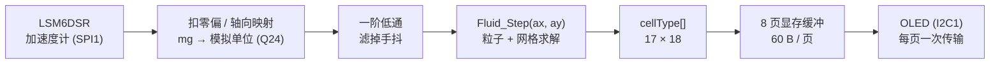
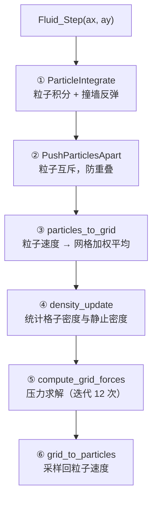

an'jian

# MSPM0G3507 流体模拟

在 LP-MSPM0G3507 LaunchPad 上运行的**实时二维流体模拟**。
把板子倾斜，板载加速度计测出重力方向，流体就顺着重力流向低位，最后静止下来。

算法移植自 CH32V203 上的 Charlieplex LED 点阵项目 `FLIP_LED`，
显示层和定点数学层在本工程中全部重写。

| 项目             | 内容                                                                             |
| ---------------- | -------------------------------------------------------------------------------- |
| 主控             | MSPM0G3507（Cortex-M0+ @ 80 MHz，**无 FPU**；128 KB Flash / 32 KB SRAM）   |
| 封装             | **VQFN-48(RGZ)**（`.syscfg` 已按 48 脚校验；当前 Demo 板是 LQFP-64(PM)） |
| 显示             | **HT16D33A 16×16 LED 点阵**（SPI0：CLK/DIO/CSB 三线，最大 48 mA 恒流）  |
| 输入             | **LSM6DS3TR-C**（WHO_AM_I=0x6A，SPI1）；流体 Demo **暂时没接它**，用假重力 |
| 算法             | FLIP/PIC 混合流体 + MAC 网格压力投影（Q24 定点 + MATHACL 硬件除法）              |
| 实测帧率         | **38 fps**（物理 ≈20.3 ms + 推屏 ≈6.0 ms = 26.3 ms/帧）                  |
| 实测占用         | Flash 31.7 KB / 128 KB，SRAM 21.9 KB / 32 KB                                     |

## 界面布局

```text
 列 0                                59 64            127
 ┌───────────────────────────────────┬────────────────┐
 │                                   │ AX   -1020     │ 页 0
 │         流体画布                    │ AY       0     │
 │        60 × 64 像素                │ AZ       0     │
 │        = 15 列 × 16 行格子          │ X0     -98     │
 │        每格 4×4 像素                │ Y2      98     │
 │                                   │ SIM     20.3   │
 │                                   │ FPS     38     │
 │                                   │ V        1     │
 └───────────────────────────────────┴────────────────┘
```

左侧画布上亮起的像素 = 非空气格子（液体或固壁）。每 4×4 像素对应一个格子：
字节低半位对应偶数行格子，高半位对应奇数行格子。

## 数据流



整条链路是**单线程超级循环**：`main()` 初始化完成后进入 `FluidDemo_Run()` 的
`for(;;)`，中间只靠一个 SysTick 中断（每 1 ms 给 `tick_ms++`）提供时间基准。
OLED 和 SPI 都是轮询（阻塞）访问，没有任何“等中断”环节。

## 流体算法

### 为什么用 FLIP/PIC 混合

纯粒子法（SPH）在 130 个粒子这种极稀疏的规模下会散成一团；纯网格法（欧拉）
会把流体抹糊。这里用的是**混合**方案：

- **粒子**负责对流：每个粒子独立运动，液面不会糊
- **网格**负责不可压缩：压力求解保证速度场无散度，液体才有“水”的感觉
- 每步结束时把网格速度按比例**混合回**粒子（FLIP/PIC 的区别就在这个比例）

### 一个时间步的六个阶段



各阶段在 80 MHz 下的实测耗时（**MATHACL 优化之前**的基线）：

| 阶段                      | 作用                  | 耗时              | 含`_IQdiv` |
| ------------------------- | --------------------- | ----------------- | ------------ |
| ①`ParticleIntegrate`   | 粒子积分 + 撞墙       | 0.25 ms           | —           |
| ②`PushParticlesApart`  | 粒子互斥（1 次迭代）  | 8.2 ms            | ✓           |
| ③`particles_to_grid`   | 粒子 → 网格          | 4.4 ms            | ✓           |
| ④`density_update`      | 密度统计              | 0.6 ms            | ✓           |
| ⑤`compute_grid_forces` | 压力求解（12 次迭代） | 6.5 ms            | —           |
| ⑥`grid_to_particles`   | 网格 → 粒子          | 8.0 ms            | ✓           |
|                           | **合计**        | **28.2 ms** |              |

> 换成 MATHACL 硬件除法后**总耗时降到约 20.3 ms**（省 7.9 ms，−28%）。
> 按上表“含 `_IQdiv`”那一列判断，省下来的时间落在 ②③⑥ 三个阶段。
> 当前 HUD 只显示总耗时 `SIM`，想看分阶段需要把计时代码加回去。

### 网格与粒子参数

| 参数            | 值                                                        | 位置             |
| --------------- | --------------------------------------------------------- | ---------------- |
| 网格            | 17 × 18（外圈为 SOLID 边界，内部可视 15 × 16 = 240 格） | `fluid.h`      |
| 粒子数          | 130                                                       | `fluid.h`      |
| 粒子半径 / 间距 | 0.017 / 0.05                                              | `fluid.h`      |
| 时间步长`dt`  | 0.032 s                                                   | `fluid_demo.c` |
| 压力迭代次数    | 12                                                        | `fluid_demo.c` |
| 撞墙弹性        | -0.9                                                      | `fluid.h`      |

> `dt = 0.032` 而一帧（物理 ≈20.3 ms + 推屏 ≈6.0 ms）只要 26.3 ms，
> 所以仿真速度是实时的 **1.22 倍** —— 看起来比现实路快一点。
> 想要正好等于实时，把 `dt` 改成约 **0.026**。
> `dt` 只出现在 `ParticleIntegrate` 的 4 次乘法里，所以改变它对总耗时的
> 影响几乎为零（压力投影是在速度场上做的，与 `dt` 无关）。

## 定点数学：为什么要自己写

原 CH32 工程用的是 WCH 的 `libIQMath_RV32.a`（Q24 定点库），但那是
**RISC-V 预编译二进制，在 ARM 上无法链接**。所以 `hardware/fluid_iqmath.h`
按相同的 Q24 语义重写了一份，只依赖标准库：

| 宏              | 实现                                                                 |
| --------------- | -------------------------------------------------------------------- |
| `_IQ(x)`      | 编译期把浮点常量折成 Q24，不产生运行时代码                           |
| `_IQmpy(a,b)` | 内联的 4 次 16×16→64 位乘法，避免调用库函数`__aeabi_lmul`        |
| `_IQdiv(a,b)` | **MATHACL 硬件除法器**（写 4 个寄存器，约 10~20 周期；见下文） |
| `_IQsqrt(a)`  | 32 次逐位 shift-add（也可以换 MATHACL，但全工程只用了 1 次，未换）   |

Cortex-M0+ 没有 FPU，也没有单指令 32×32 乘法，所以 Q24 乘法的开销必须认真
对待 —— 详见下一节。

## 性能优化

从“能跑”到“38 fps”一共做了五件事，每一步都有实测数据支撑：

| # | 改动                                                                          | 效果                                        | 依据                                                     |
| - | ----------------------------------------------------------------------------- | ------------------------------------------- | -------------------------------------------------------- |
| 1 | OLED 推屏从**逐字节**（1 字节 1 次 I2C 事务）改成**一页一次事务** | 4~6 fps → 1.77 ms/页，8 页 14.2 ms         | 逐字节方式全屏要 150~250 ms                              |
| 2 | 热点函数搬进 SRAM（`.TI.ramfunc`）+ 乘法内联                                | 50.7 ms → 31.6 ms（1.60×）                | 含除法的阶段提升小、不含的提升大（INT 2.5×、DEN 3.2×） |
| 3 | `_IQdiv` 从 64 位整数除法改为软浮点除法                                     | 31.6 ms → 28.2 ms（−11%）                 | INT/DEN/PRS 不含除法，耗时不变；SEP/TOG/FRG 掉了 10~20%  |
| 4 | `_IQdiv` 改用 **MATHACL 硬件除法器**                                  | 物理 28.2 ms →**≈20.3 ms**（−28%） | 单次除法从 ~700 周期降到 ~20 周期                        |
| 5 | I2C 从 400 kHz 提到**1 MHz**（Fast Mode Plus）                          | 推屏 14.2 ms →**≈6.0 ms**           | 每字节 9 个时钟，72 字节/页，86% 总线效率                |

合计：**42.4 ms/帧 → 26.3 ms/帧，23.6 fps → 38 fps**（提升 1.6 倍）。

关键教训：**优化前先测**。一开始我以为瓶颈在压力求解（迭代 12 次听起来很贵），
但实测四个迭代次数（12/8/4/1）的耗时符合 `SIM ≈ 406 + 8.6 × GI`，
说明压力求解只占约 10 ms（4%），固定开销占了 96%。

另一条教训：**用“改动前后的差值”定位瓶颈，比读汇编数指令可靠**。
第 3、4 两步都是只换除法实现，通过对比“含除法 / 不含除法”两类阶段的
耗时变化，就能反推出除法到底占了多长时间。

## 硬件加速：MATHACL

MSPM0G3507 内置 **MATHACL 数学加速器**（TI 官方描述为 “Trigonometric math
accelerator”），提供定点除法、开方、sin/cos、四象限反正切、乘加等运算。
本工程用它替换了 Q24 除法。

**开启方式（三步，不需要配任何参数）**：

1. `gpio_toggle_output.syscfg` 里加模块：

   ```javascript
   const MATHACL = scripting.addModule("/ti/driverlib/MATHACL");
   ```
2. SysConfig 生成的 `SYSCFG_DL_init()` 里会出现两行 —— **少了第二行会静默失效**
   （寄存器写得进，但结果永远是 0，很难查）：

   ```c
   DL_MathACL_reset(MATHACL);
   DL_MathACL_enablePower(MATHACL);
   ```
3. 直接读写寄存器。调用序列**必须**按这个顺序：

   ```c
   MATHACL->CTL = 操作码 | (Q格式 << 8) | (1 << 5);  /* bit5 = 立即触发 */
   MATHACL->OP2 = 第二个操作数;
   MATHACL->OP1 = 第一个操作数;   /* 写 OP1 就是发令，必须最后写 */
   结果 = MATHACL->RES1;          /* 读 RES1 时硬件会 hold 总线直到算完 */
   ```

**没有轮询循环、没有中断**：写 `OP1` 触发，读 `RES1` 取结果，靠 AHB 等待自动同步。

本工程用到的操作码（Q24 时的 CTL 值）：

| 操作 | 操作码 | CTL                                   |
| ---- | ------ | ------------------------------------- |
| DIV  | 4      | `0x1824` = `4 \| (24<<8) \| (1<<5)` |

验证方法：用 `tiarmclang -S` 输出汇编，常量池里应该能看到 `.long 6180`（即
`0x1824`）和 `_IQdiv` 的 4 条寄存器访问。

**`_IQmpy` 故意没换**。FOC 工程用 `-D_IQ_MPY_MATHACL_INLINE` 把乘法也交给
MATHACL，那是因为它用 **IQ27**：32×32 乘法要 64 位中间结果 → 汇编里是
`__aeabi_lmul`（约 30~60 周期 + 函数调用）。而本工程的 **Q24 乘法已经内联成
4 次 16×16 乘法**（约 30 周期、无调用），再换成 MATHACL 要付出 4 次外设总线
访问，收益存疑甚至可能变慢。

> ⚠️ **MATHACL 不可重入** —— 只有一组 `CTL/OP1/OP2/RES1`。目前只有主循环用它，
> 安全；以后如果中断里也要用，必须加互斥。

## 调试 HUD

| 行               | 含义                                                                                    |
| ---------------- | --------------------------------------------------------------------------------------- |
| `AX / AY / AZ` | 加速度计三轴读数（mg，已扣零偏、已做安装方向翻转）                                      |
| `X? / Y?`      | **实际送入流体算法**的值（模拟单位 ×10）及它的来源轴，如 `Y2` = 屏幕 y 取自 AZ |
| `SIM`          | 单步物理平均耗时（0.1 ms，即`282` = 28.2 ms）                                         |
| `FPS`          | 帧率                                                                                    |
| `V`            | 垂直于屏幕平面的那个轴号（0/1/2）—— 这个轴不能用来驱动流体                            |

HUD 走的是慢速逐字节接口，所以每 20 帧才刷新一次（`HUD_UPDATE_FRAMES`）。

## 显示刷新

每个时间步都把 `cellType[]` 重新组装成 8 页显存缓冲，然后**一页一次 I2C 事务**
整帧推出去。

| I2C 速率                          | 每页耗时            | 整帧（8 页）       |
| --------------------------------- | ------------------- | ------------------ |
| 400 kHz（标准 Fast Mode）         | 1.77 ms             | 14.2 ms            |
| **1 MHz（Fast Mode Plus）** | **≈0.75 ms** | **≈6.0 ms** |

每页 72 字节 = 3 个定位命令 + 1 个控制字节 + 60 字节像素数据。I2C 每个字节占
9 个时钟（8 数据 + 1 ACK），实测总线利用率约 86%。

> ⚠️ **1 MHz 对 SSD1306 是超规格的**。SSD1306 数据手册只保证到 400 kHz，
> 1 MHz 属于 Fast Mode Plus，能不能跑取决于芯片批次和板上上拉电阻。
> 本板实测可行，但**换屏 / 换板必须重新验证** —— 判据是 HUD 的 `ERR` 是否保持 0
> （驱动里每页推送失败都会累加 `s_err`）。
> 另外 1 MHz 对总线的上升时间要求更严，上拉电阻需要适当减小。

## 硬件接线

| 功能                                        | 引脚                        |
| ------------------------------------------- | --------------------------- |
| OLED SCL / SDA（I2C1）                      | PB2 / PB3                   |
| IMU SPI SCLK / PICO / POCI / CS             | PB16 / PB15 / PB14 / PB9    |
| 指示 LED（`clock_selftest` 的 1 Hz 心跳） | PB8                         |
| LED 显示`GPIO_LED_SHOW` PIN_1…PIN_16     | **PA0–PA15**（连续） |
| 预留 UART_0（UART1）TX / RX                 | PB6 / PB7                   |
| SWD 调试                                    | PA19 / PA20                 |

`.syscfg` 里的模块：`SYSCTL`、`MATHACL`、`I2C1`（OLED）、`SPI1`（IMU）、
`SPI0`（LED 驱动）、`UART1`（预留串口）、`ADC0`（电池采样）、
`TIMA0`（**5 ms 按键节拍**），GPIO 组 5 个：`GPIO_LSM6DS3TRC`（IMU 片选）、
`LED`（指示灯）、`GPIO_LED_DRV`（LED 驱动 CSB）、`GPIO_PWR`（电源自锁 PA22）、
`GPIO_USERKEY`（USER1/2/3 = PA25/24/23），以及 `Board`（SWD）。

**所有外设和引脚都已显式 `$assign`**，所以重新生成、换封装时自动求解器
**不会**再改动引脚分布。

> ⚠️ `.syscfg` 里的 `//` 注释会在你用 **SysConfig 图形界面保存时被抹掉**
> （工具会重写整个文件）。想留注释就写在 README 里。

### 一键开关机与 3 路按键

| 功能                        | 引脚                              | 上拉               |
| --------------------------- | --------------------------------- | ------------------ |
| 电源自锁 `PWR_HOLD`         | PA22（输出，上电即为高）           | —                  |
| USER1（一键开关机用）       | PA25                              | MCU **内部**上拉   |
| USER2                       | PA24                              | 板上**外部**上拉   |
| USER3                       | PA23                              | 板上**外部**上拉   |

三个键都是**按下 = 低电平**。开机自锁由 SysConfig 的 `initialValue = SET` 在
`SYSCFG_DL_GPIO_init()` 里完成（先 `setPins` 再 `enableOutput`），**不需要开机代码**。

- **开机**：按键按下 → 硬件给电 → MCU 上电 → 自锁。
  ⚠ 此刻按键**还按着**、USER1 读到低，所以状态机必须**先等它松开**才允许关机
  —— 少了这一步的症状就是"一上电立刻关机，永远开不了机"。
- **关机**：就绪后 **长按 USER1 两秒**（`POWER_OFF_HOLD_MS`）→ 拉低 PA22 → 松手断电。

按键扫描与去抖在 [hardware/key.c](hardware/key.c)（20 ms 去抖），开关机状态机在
[hardware/power.c](hardware/power.c)，两者都由 **TIMA0 的 5 ms 中断**每拍驱动
（`main()` 里 `NVIC_EnableIRQ(TIMER_0_INST_INT_IRQN)`）。放中断里而不是主循环，
是为了主循环一旦卡死也还能关机 —— 否则 PA22 永远放不掉，用户只能拔电池。

> ⚠️ **TIMA0 是 16 位计数器**：5 ms 在 40 MHz 下要 200000 拍、放不下，
> 所以 `TIMER1.timerClkDiv` 必须同时从 2 改成 **8**（40 MHz → 10 MHz，LOAD = 49999）。
> 连带影响：`DBG_TicksToUs()` 的除数从 40 改成 **10**（1 拍 25 ns → 100 ns），
> 否则 `dbg.perf.read_us` 会显示成真实值的 1/4。

### 为什么 LED 显示要用连续的 PA0–PA15

16 根 LED 显示引脚必须**全在同一个端口**，这样将来可以用
`DOUTSET31_0` / `DOUTCLR31_0` / `DOESET31_0` / `DOECLR31_0`
**一次寄存器写入就设好一个相位的全部三态**，不用逐个引脚操作。

为了把 PORTA 低 16 位完全腾出来，OLED（原本 PA15/PA16）、指示 LED（PA7）、
UART_0（PA8/PA9）全部搬到了 PORTB，同时删掉了第二路串口。
完整的「最初 → 现在」对照表见下文「48 脚封装」一节。

> ⚠️ **接线要同步改**：OLED 的 SCL/SDA 从 PA15/PA16 改到 **PB2/PB3**，
> 指示 LED 从 PA7 改到 **PB8**，UART_0 从 PA8/PA9 改到 **PB6/PB7**。

> 目前 `GPIO_LED_SHOW` 只完成了引脚配置，**还没有驱动程序** ——
> 驱动（Charlieplex 扫描 + TIMER_0 中断）待实现。

UART_0 和 TIMER_0 的初始化与中断处理函数都保留着，但 **NVIC 是关闭的**
（在 `gpio_toggle_output.c` 的 `main()` 里放开就能用，具体写法见那里的注释）。

## 目录结构

| 路径                                      | 内容                                                            |
| ----------------------------------------- | --------------------------------------------------------------- |
| `gpio_toggle_output.c`                  | `main`、SysTick 节拍、三个预留的中断处理函数                  |
| `gpio_toggle_output.syscfg`             | 外设与引脚配置（SysConfig 图形化）                              |
| `hardware/fluid.c` / `fluid.h`        | **流体算法本体**，零外设依赖，可原样拿到 PC 上编译        |
| `hardware/fluid_iqmath.h`               | Q24 定点数学库                                                  |
| `hardware/fluid_demo.c` / `.h`        | 胶水层：假重力 → 算法 → LED 点阵（暂不接 IMU）                  |
| `hardware/clock.c` / `.h`             | `tick_ms` 1 ms 节拍、SysTick 初始化                           |
| `hardware/IMU660RB/`                    | LSM6DSR 驱动（含 Fusion 姿态库，本工程只用其初始化）            |
| `hardware/lsm6ds3trc.c` / `.h`        | LSM6DS3TR-C（WHO_AM_I=0x6A）最简 SPI 驱动，读六轴 + 温度      |
| `hardware/debug.c` / `.h`             | 观测量结构体 `dbg` + 时间打点/窗口统计 + HardFault 现场捕获    |
| `hardware/imu_selftest.c` / `.h`      | 可选：陀螺仪读取自检（**无屏**，观测量全在 `dbg`），默认 0 |
| `hardware/key.c` / `.h`               | 3 路按键扫描 + 20 ms 去抖（TIMA0 5 ms 中断里跑）                |
| `hardware/power.c` / `.h`             | 电源自锁（PA22）+ 一键开关机（长按 2 s 关机）                    |
| `hardware/ht16d33a.c` / `.h`          | HT16D33A 16×16 LED 点阵驱动（SPI0：CLK/DIO/CSB 三线）           |
| `hardware/led_matrix.c` / `.h`        | 映射层：面板 (列,行) → 芯片 (扫描/数据通道) → 显示 RAM 位        |
| `hardware/led_show.c` / `.h`          | LED 综合演示序列（全亮→全黑→游走→图案）+ 串口可调用的接口，**当前 = 0** |
| `Debug/`                                | CCS 生成的构建脚本（`makefile`、`subdir_vars.mk` 等）与产物 |

几个演示/自检程序都由头文件里的 `*_ENABLE` 开关控制：为 0 时它们的函数
无人调用，会被链接器段回收丢掉，**不占任何 Flash**。
`imu_selftest` 默认 0；`led_show` 当前也是 **0** —— 让位给流体模拟，
`main()` 里跑的是 [hardware/fluid_demo.c](hardware/fluid_demo.c)。
LED 演示 / IMU 自检在 `main()` 里用 `#if/#elif` 互斥，优先级
**LED > IMU > 流体**；想跑哪个就把它置 1、并把优先级更高的那个关掉。

> **OLED 显示相关代码已全部删除**（`oled_hardware_i2c.*`、`oledfont.h`、
> `oled_selftest.*`，以及只把结果画在 OLED 上的 `clock_selftest.*`）。
> syscfg 里的 `I2C_OLED` 实例还留着没动，要彻底清掉得改 `.syscfg` 再重新生成。

### 流体模拟 → LED 点阵（hardware/fluid_demo.c）

`fluid.c` 是纯算法（15 列 × 16 行可视区，和面板 240 颗一一对应），本文件只是胶水层：

| 部分 | 做法 |
| ---- | ---- |
| 驱动 | **假重力**：方向每 2 s 换一次（下→左→上→右），让液体四个方向都流一遍，也顺便验证显示方向 |
| 渲染 | `cellType[]` 非空气（液体 + 固体边框）就走 `LedMatrix_SetCell(x, y)` 点亮，最后一帧一次推屏 |
| 观测量 | 全在 `dbg.fluid`：`ax10/ay10`、`sim_ms_x10`（单步物理耗时 ×10）、`fps`、`frames`、`tilt`、`iq_ok` |
| 数学层自检 | 开机先验 `_IQmpy/_IQdiv/_IQsqrt`；失败就把**整屏点亮**停住（结果记在 `dbg.fluid.iq_ok`）|

参数在文件顶部：`DEMO_TILT_MS`（换向周期）、`DEMO_DT`（时间步长 0.032）、
`DEMO_GRID_ITER`（压力迭代 12 次）。

**接 IMU 时**只需替换取 `(ax, ay)` 那几行（现在是查 `s_tiltAcc[4][2]` 表）。

### LED 点阵（HT16D33A）综合演示

只有**一个**模式，上电就循环播放（实现 [hardware/led_show.c](hardware/led_show.c)）：

| 段 | 时长 | 内容 |
| -- | ---- | ---- |
| ① 全亮 | 500 ms | 面板上 240 颗（走映射，不碰 CA19 那些没有 LED 的槽） |
| ② 全黑 | 500 ms | 顺便当残影检查 |
| ③ 逐位游走 | 240 × 20 ms | **按映射表**的 (行,列) 光栅顺序走一格，干净地从左到右、从上到下 |
| ④ 图案 | 2000 ms | 外框 + 主对角线 + 左上角 2×2 实心块（顺便当方向标定图案） |

一轮 ≈ 7.8 秒，然后循环。各段时长是 [hardware/led_show.h](hardware/led_show.h) 顶部的
`LED_SHOW_*_MS` 宏，改完重编即可。

**给以后串口指令预留的接口**（同一个头文件）：

```c
LedShow_Start();        /* 从头开始播放。只写一个标志位，从串口中断里调也安全 */
LedShow_Stop();         /* 立即停 */
LedShow_IsActive();     /* 1 = 正在播放 */
LedShow_Task();         /* ⚠ 主循环里每 ≥1ms 调一次（里面有 SPI，别放中断里）*/
LedShow_Run();          /* 初始化 + 死循环，给 main() 当独立演示程序用 */
```

接进别的应用（比如流体）时用前 4 个：串口命令里调 `LedShow_Start()`，主循环里调
`LedShow_Task()`，并用 `LedShow_IsActive()` 判断要不要让出显示权。

**观测量**：`dbg.led.show_stage`（0 没在播 / 1 全亮 / 2 全黑 / 3 游走 / 4 图案）、
`dbg.led.step`（游走格号 0..239）、`dbg.led.xfer`（每帧 +34）、`dbg.led.timeout`（应恒 0）。

### 面板映射（hardware/led_matrix.c）

手册只给了"逻辑通道 → RAM 位"的公式，**这块面板的引脚和逻辑通道之间还差两次旋转**，
全部收在 [hardware/led_matrix.c](hardware/led_matrix.c) 里，上层只认 (列, 行)：

| 事实 | 内容 |
| ---- | ---- |
| 引脚编号 | 16×16 的有效脚 = S1..S17 = `CA1..CA8, CA10, CA12..CA18, CA19`（CA9/CA11 高阻，跳过） |
| 面板走线 | **阶梯形**：第 r 行的阴极一律是 S(c)；阳极多为 S(17−r)，但 `c > 16−r` 那一小段改用 S(16−r)（切点每下一行左移 1 格） |
| 扫描通道 | 通道与阳极引脚一一对应：`n = a`（即通道 1 ↔ CA1、…、通道 16 ↔ CA18）<br>⚠ 一开始误以为是反序轮转，现象是光栅在第 15 步从"第一行最后一颗"跳到"最后一行最后一列"；**修正后已实测通过** |
| 数据通道 | 手册规定本相位的脚不参与数据，所以 `m = c − (c > a ? 1 : 0)` |
| 最终 | `addr = 2×(n−1) + (m−1)/8`、`bit = (m−1)%8` |

因此：**面板 16 列 × 15 行 = 240 颗 ↔ 240 个 RAM 位**（脚本核对过是双射，无重复无缺漏）；
**16 个用不到的 RAM 位正好是每一相的 m=16 → 全部指向 CA19**，所以 CA19 悬空是正确的。
每一相恰好 15 颗 × 16 相 = 240 ✓。**整个映射层已用实测光栅验证通过。**

> ⚠️ 按原始 RAM 顺序逐位走（比如不经过映射直接写位）看起来会"斜着走"，那是阶梯形
> 走线造成的，**不是 bug**；走映射层才是干净的光栅。

**方向开关**（面板 16 列 × 15 行 与 流体网格 15 列 × 16 行 是转置关系）：
看综合演示的**图案段**（外框 + 对角线 + 左上角 2×2 块）调
[hardware/led_matrix.h](hardware/led_matrix.h) 里的 `LED_ORIENT_SWAP_XY / FLIP_X / FLIP_Y`，
目标是把实心块摆到设备的左上角。

```c
LedMatrix_Init();                 /* 初始化芯片（含清屏） */
LedMatrix_Clear();                /* 清本地帧缓冲 */
LedMatrix_SetCell(x, y);          /* 按流体网格坐标点格子 */
LedMatrix_FillAll(1u);            /* 全亮（走映射，不碰没有 LED 的槽）*/
LedMatrix_Flush();                /* 整帧推送：FD 00 + 80 00 ×32，约 144µs */
```

> **OLED 相关代码已全部删除**：`oled_hardware_i2c.*`、`oledfont.h`、`oled_selftest.*`，
> 以及只把结果画在 OLED 上的 `clock_selftest.*`。原来那个把主循环堵住的
> `OLED_DISPLAY_ENABLE` 开关也随之消失（OLED 器件不在总线上时，
> `OLED_Clear()` 会逐字节等 I2C 超时，一屏 1024 字节 ≈ 10 秒）。
> syscfg 里的 `I2C_OLED` 实例还留着（PB2/PB3），要彻底清掉得改 `.syscfg` 再重新生成。

## 编译与烧录

环境：

- Code Composer Studio 20.5.0
- TI Arm Clang `ti-cgt-armllvm_4.0.4.LTS`（`C:/ti/ccs2050/ccs/tools/compiler/`）
- MSPM0 SDK `2.10.00.04`（`C:/ti/mspm0_sdk_2_10_00_04`）

命令行编译：

```powershell
C:\ti\ccs2050\ccs\utils\bin\gmake.exe -C "Debug" -j 16 all
```

或在 CCS 里直接 Build。产物是
`Debug/gpio_toggle_output_LP_MSPM0G3507_nortos_ticlang.out`。

烧录：在 CCS 里 Debug / Flash，或把 `.out` 拖进 UniFlash。

> ⚠️ 仓库里 `.vscode/tasks.json` 的“编译 MSPM0 工程”任务写的是 `ccs2041` 路径，
> 那个目录不存在。要么改成上面的 `ccs2050`，要么直接用命令行。

## 可调参数

| 想改什么                               | 改哪里                                                        |
| -------------------------------------- | ------------------------------------------------------------- |
| 粒子数、网格尺寸、粒子半径、弹性、间距 | `hardware/fluid.h`                                          |
| 时间步长`dt`、压力迭代次数           | `hardware/fluid_demo.c` 的 `DEMO_DT` / `DEMO_GRID_ITER` |
| 加速度计轴向映射、符号、低通系数       | `hardware/fluid_demo.c` 顶部的 `ACC_*` 宏                 |
| HUD 刷新频率                           | `hardware/fluid_demo.c` 的 `HUD_UPDATE_FRAMES`            |
| 引脚和外设                             | `gpio_toggle_output.syscfg`（用 CCS SysConfig 改）          |

### 换板子后要重标定加速度计轴向

本板子的实测结论（已写死在 `fluid_demo.c`）：

```c
#define ACC_MOUNT_SIGN  (-1)   /* IMU 倒装，三轴全反 */
#define ACC_PERP_AXIS   1      /* AY 垂直于屏幕平面 */
#define ACC_SRC_X       0      /* 屏幕 x ← AX */
#define ACC_SRC_Y       2      /* 屏幕 y ← AZ */
#define ACC_SIGN_X     (-1)
#define ACC_SIGN_Y     (+1)
```

重测流程：

1. 开机把板子**平放（屏幕朝上）静止**，看 HUD 的 `AX/AY/AZ` —— 哪个绝对值接近
   `1000`，那个轴就**垂直于屏幕**，把它的序号填到 `ACC_PERP_AXIS`
2. `ACC_SRC_X` / `ACC_SRC_Y` 填剩下的两个面内轴
3. 拿起板子倾斜，目标是**压低哪一边液体就往哪一边流**；方向不对就翻
   `ACC_SIGN_X` / `ACC_SIGN_Y`
4. 把板子翻过来拿（屏幕朝下），液体应该跑到屏幕上方

> **两层符号别搞混**：`ACC_MOUNT_SIGN` 描述**硬件安装方向**（三轴统一翻转），
> `ACC_SIGN_X/Y` 描述**屏幕映射**（逐轴）。只有上下反了就只翻 `ACC_SIGN_Y`，
> 千万别动 `ACC_MOUNT_SIGN`，那会把左右一起翻掉。

> 上面的 `ACC_PERP_AXIS` 也可以用开机自动检测代替，但那个检测要求开机时
> 板子平放，而且会把 1g 重力当成零偏的风险带进来，所以现在固定写死了。

### 48 脚封装（VQFN-48 RGZ）

`.syscfg` 已经切到 **VQFN-48(RGZ)**（头部 `@cliArgs` / `@v2CliArgs`）。
关键的器件事实：**48 脚的 44 个 GPIO 是 64 脚的完全子集**，所以只要引脚选在
两边都有的那些上，换封装时**应用代码一行都不用改** —— 代码里全是 SysConfig 的
逻辑名（`GPIO_I2C_OLED_IOMUX_SCL`、`SPI_LSM6DS3TRC_INST`……），端口号和引脚号
由自动生成的 `ti_msp_dl_config.h` 决定。

48 脚上**不存在**的 16 个引脚（永远不要用）：

```text
PA29 PA30 PB0  PB1  PB4  PB5  PB10 PB11
PB12 PB13 PB21 PB22 PB23 PB25 PB26 PB27
```

#### 已完成的引脚调整

| 功能             | 最初        | 现在                |
| ---------------- | ----------- | ------------------- |
| IMU SCLK         | PA17        | **PB16**      |
| IMU PICO（MOSI） | PB22 ✗     | **PB15**      |
| IMU POCI（MISO） | PB14        | PB14                |
| IMU 片选 CS      | PB0 ✗      | **PB9**       |
| OLED SCL / SDA   | PA15 / PA16 | **PB2 / PB3** |
| 指示 LED         | PA7         | **PB8**       |
| UART_0 TX / RX   | PA8 / PA9   | **PB6 / PB7** |
| UART_1（UART3）  | PB2 / PB3   | **已删除**    |
| LED 显示 ×16    | —          | **PA0–PA15** |

迁移后在 VQFN-48 上的剩余可用引脚：

- **PORTA**：PA16、PA17、PA18、PA21–PA28、PA31（共 12 个）
- **PORTB**：PB17、PB18、PB19、PB20、PB24（共 5 个）

> 换板子时唯一不能省的硬件项：**VCORE 的外部去耦电容**。

## 开发注意事项

几个踩过的坑，改代码前先看一眼：

1. **gmake 不跟踪头文件依赖**。`subdir_rules.mk` 只生成 `.d_raw`，没有转成 `.d`
   的步骤，所以改了 `.h` 之后 make 可能不会重编受影响的 `.c`。
   **改完头文件记得手动删掉对应的 `.o` 再编译。**
2. **增删 `.c` 文件要改 4 个地方**：

   - `Debug/hardware/subdir_vars.mk` 的 `C_SRCS` / `C_DEPS` / `OBJS`
   - 同文件的 `C_SRCS__QUOTED` / `C_DEPS__QUOTED` / `OBJS__QUOTED`
   - `Debug/makefile` 的 `ORDERED_OBJS`（**链接实际用的是这个**）
   - `Debug/makefile` 的 `clean:` 规则
3. **`Debug/ti_msp_dl_config.c/.h` 是自动生成的，不要手改**。
   `Debug/subdir_rules.mk` 里 `ti_msp_dl_config.c/h`、`device_linker.cmd` 都依赖
   `../gpio_toggle_output.syscfg`，并会调用 `sysconfig_cli.bat` 重新生成。
   也就是**每次构建**都会跑一遍 SysConfig（日志里的
   `Writing ...ti_msp_dl_config.c...`）。所以改完 `.syscfg` 直接 `make` 就行，
   不需要在 CCS 里再手动保存一次；反过来，手改生成的文件一定会被覆盖。
4. **80 MHz 时钟与 SysConfig 时钟树互斥**：`.syscfg` 里必须
   `clockTreeEn = false` 且不勾选 `forceDefaultClkConfig`，否则 SysConfig 会
   忽略 `SYSPLL_Pdiv/Qdiv/CLK2XDiv` 这些字段。时钟分频规则：
   MCLK 域外设（UART/SPI/I2C/TIMA0）是 **80 MHz**，
   ULPCLK 域（TIMG0/6/7/8/12、ADC12）是 **40 MHz**。
5. **git 的 `core.autocrlf=true`**：`git add` 时会出现一堆
   `LF will be replaced by CRLF` 警告，无害。

## 已知限制与后续可做

- **当前阶段：陀螺仪（LSM6DS3TR-C）读取验证**。`hardware/lsm6ds3trc.c` 只做
  寄存器读写与原始值换算，不做姿态解算；结果全部落在 `dbg` 里，用 CCS 的
  Expressions 展开 `dbg` 看（`hardware/imu_selftest.c` 只负责不停采样）。
  解算结果后续往 `dbg.att` 里填。
- 推屏约 6.0 ms 期间 CPU 完全空转（I2C 轮询）。改成 **I2C 中断或 DMA** 能把这
  6 ms 还给物理计算，帧率可达约 **48 fps**。这是目前最值得做的一次改造。
- 每帧都推全部 8 页。改成**只推变化的页**能省一部分，液体静止时几乎全免。
- 单个格子目前只有“亮 / 灭”两种状态（4×4 像素全亮或全灭）。
  用 **Bayer 抖动**按粒子密度做伪灰度会好看很多。
- 粒子数 130 偏少，液面有颗粒感。加粒子能变细腻，但 ②③⑥ 三个阶段与粒子数
  成正比，物理耗时会线性上升。
- 物理耗时现在的大头是 ② `PushParticlesApart` 和 ⑥ `grid_to_particles`
  （都是粒子 → 网格的邻域遍历）。可以试试把邻域查询用的空间换到 SRAM，
  或者把压力迭代次数和粒子数做个权衡。
- **6 轴里的陀螺仪完全没用上** —— 驱动读了 6 轴，应用只取 3 轴加速度计，
  进算法的只有 2 轴。陀螺可以用来做两件事：
  - **互补滤波**：重力向量 + 角速度积分，得到更干净的重力估计，
    顺带抑制“快速平移被误判成倾斜”
  - **涡旋注入**：拿绕屏幕法线的角速度给流体加切向速度，
    做成“转手腕液体打旋”的效果
