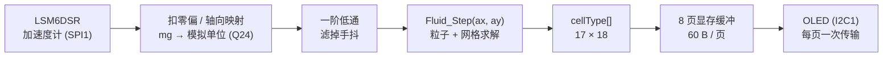
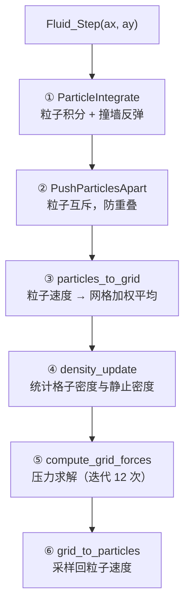

# MSPM0G3507 流体模拟

在 LP-MSPM0G3507 LaunchPad 上运行的**实时二维流体模拟**。
把板子倾斜，板载加速度计测出重力方向，流体就顺着重力流向低位，最后静止下来。

算法移植自 CH32V203 上的 Charlieplex LED 点阵项目 `FLIP_LED`，
显示层和定点数学层在本工程中全部重写。

| 项目 | 内容 |
| --- | --- |
| 主控 | MSPM0G3507（Cortex-M0+ @ 80 MHz，**无 FPU**；128 KB Flash / 32 KB SRAM） |
| 显示 | SSD1306 OLED 128×64，I2C1 @ 400 kHz |
| 输入 | LSM6DSR（板上丝印 `IMU660RB`），SPI1，只取加速度计 |
| 算法 | FLIP/PIC 混合流体 + MAC 网格压力投影（Q24 定点） |
| 实测帧率 | **23.6 fps**（物理 28.2 ms + 推屏 14.2 ms = 42.4 ms） |
| 实测占用 | Flash 33.5 KB / 128 KB，SRAM 22.7 KB / 32 KB |

## 界面布局

```text
 列 0                                59 64            127
 ┌───────────────────────────────────┬────────────────┐
 │                                   │ AX   -1020     │ 页 0
 │         流体画布                    │ AY       0     │
 │        60 × 64 像素                │ AZ       0     │
 │        = 15 列 × 16 行格子          │ X0     -98     │
 │        每格 4×4 像素                │ Y2      98     │
 │                                   │ SIM     28.2   │
 │                                   │ FPS     23     │
 │                                   │ V        1     │
 └───────────────────────────────────┴────────────────┘
```

左侧画布上亮起的像素 = 非空气格子（液体或固壁）。每 4×4 像素对应一个格子：
字节低半位对应偶数行格子，高半位对应奇数行格子。

## 数据流



整条链路是**单线程超级循环**：`main()` 初始化完成后进入 `FluidDemo_Run()` 的
`for(;;)`，中间只靠一个 SysTick 中断（每 1 ms 给 `tick_ms++`）提供时间基准。
OLED 和 SPI 都是轮询（阻塞）访问，没有任何“等中断”环节。

## 流体算法

### 为什么用 FLIP/PIC 混合

纯粒子法（SPH）在 130 个粒子这种极稀疏的规模下会散成一团；纯网格法（欧拉）
会把流体抹糊。这里用的是**混合**方案：

- **粒子**负责对流：每个粒子独立运动，液面不会糊
- **网格**负责不可压缩：压力求解保证速度场无散度，液体才有“水”的感觉
- 每步结束时把网格速度按比例**混合回**粒子（FLIP/PIC 的区别就在这个比例）

### 一个时间步的六个阶段



各阶段在 80 MHz 下的实测耗时：

| 阶段 | 作用 | 耗时 |
| --- | --- | --- |
| ① `ParticleIntegrate` | 粒子积分 + 撞墙 | 0.25 ms |
| ② `PushParticlesApart` | 粒子互斥（1 次迭代） | 8.2 ms |
| ③ `particles_to_grid` | 粒子 → 网格 | 4.4 ms |
| ④ `density_update` | 密度统计 | 0.6 ms |
| ⑤ `compute_grid_forces` | 压力求解（12 次迭代） | 6.5 ms |
| ⑥ `grid_to_particles` | 网格 → 粒子 | 8.0 ms |
| | **合计** | **28.2 ms** |

### 网格与粒子参数

| 参数 | 值 | 位置 |
| --- | --- | --- |
| 网格 | 17 × 18（外圈为 SOLID 边界，内部可视 15 × 16 = 240 格） | `fluid.h` |
| 粒子数 | 130 | `fluid.h` |
| 粒子半径 / 间距 | 0.017 / 0.05 | `fluid.h` |
| 时间步长 `dt` | 0.032 s | `fluid_demo.c` |
| 压力迭代次数 | 12 | `fluid_demo.c` |
| 撞墙弹性 | -0.9 | `fluid.h` |

> `dt = 0.032` 而一步物理只花 28 ms，所以仿真速度约是实时的 **1.13 倍**。
> `dt` 只出现在 `ParticleIntegrate` 的 4 次乘法里，所以改变它对总耗时的
> 影响几乎为零（压力投影是在速度场上做的，与 `dt` 无关）。

## 定点数学：为什么要自己写

原 CH32 工程用的是 WCH 的 `libIQMath_RV32.a`（Q24 定点库），但那是
**RISC-V 预编译二进制，在 ARM 上无法链接**。所以 `hardware/fluid_iqmath.h`
按相同的 Q24 语义重写了一份，只依赖标准库：

| 宏 | 实现 |
| --- | --- |
| `_IQ(x)` | 编译期把浮点常量折成 Q24，不产生运行时代码 |
| `_IQmpy(a,b)` | 内联的 4 次 16×16→64 位乘法，避免调用库函数 `__aeabi_lmul` |
| `_IQdiv(a,b)` | 用**软浮点除法**（比 64 位整数除法快约 300 个周期） |
| `_IQsqrt(a)` | 32 次逐位 shift-add |

Cortex-M0+ 没有 FPU，也没有单指令 32×32 乘法，所以 Q24 乘法的开销必须认真
对待 —— 详见下一节。

## 性能优化

从“能跑”到“23.6 fps”主要做了三件事，每一步都有实测数据支撑：

| # | 改动 | 效果 | 依据 |
| --- | --- | --- | --- |
| 1 | OLED 推屏从**逐字节**（1 字节 1 次 I2C 事务）改成**一页一次事务** | 4~6 fps → 1.77 ms/页，8 页 14.2 ms | 逐字节方式全屏要 150~250 ms |
| 2 | 热点函数搬进 SRAM（`.TI.ramfunc`）+ 乘法内联 | 50.7 ms → 31.6 ms（1.60×） | 含除法的阶段提升小、不含的提升大（INT 2.5×、DEN 3.2×） |
| 3 | `_IQdiv` 从 64 位整数除法改为软浮点除法 | 31.6 ms → 28.2 ms（−11%） | INT/DEN/PRS 不含除法，耗时不变；SEP/TOG/FRG 掉了 10~20% |

关键教训：**优化前先测**。一开始我以为瓶颈在压力求解（迭代 12 次听起来很贵），
但实测四个迭代次数（12/8/4/1）的耗时符合 `SIM ≈ 406 + 8.6 × GI`，
说明压力求解只占约 10 ms（4%），固定开销占了 96%。

## 调试 HUD

| 行 | 含义 |
| --- | --- |
| `AX / AY / AZ` | 加速度计三轴读数（mg，已扣零偏、已做安装方向翻转） |
| `X? / Y?` | **实际送入流体算法**的值（模拟单位 ×10）及它的来源轴，如 `Y2` = 屏幕 y 取自 AZ |
| `SIM` | 单步物理平均耗时（0.1 ms，即 `282` = 28.2 ms） |
| `FPS` | 帧率 |
| `V` | 垂直于屏幕平面的那个轴号（0/1/2）—— 这个轴不能用来驱动流体 |

HUD 走的是慢速逐字节接口，所以每 20 帧才刷新一次（`HUD_UPDATE_FRAMES`）。

## 硬件接线

| 功能 | 引脚 |
| --- | --- |
| OLED SDA / SCL | PA16 / PA15 |
| IMU SPI SCLK / PICO / POCI / CS | PA17 / PB22 / PB14 / PB0 |
| 预留 UART_0（UART1）TX / RX | PA8 / PA9 |
| 预留 UART_1（UART3）RX | PB3 |

两路 UART 和 TIMER_0 的初始化与中断处理函数都保留着，但 **NVIC 是关闭的**
（在 `gpio_toggle_output.c` 的 `main()` 里放开就能用，具体写法见那里的注释）。

## 目录结构

| 路径 | 内容 |
| --- | --- |
| `gpio_toggle_output.c` | `main`、SysTick 节拍、三个预留的中断处理函数 |
| `gpio_toggle_output.syscfg` | 外设与引脚配置（SysConfig 图形化） |
| `hardware/fluid.c` / `fluid.h` | **流体算法本体**，零外设依赖，可原样拿到 PC 上编译 |
| `hardware/fluid_iqmath.h` | Q24 定点数学库 |
| `hardware/fluid_demo.c` / `.h` | 胶水层：IMU → 算法 → OLED，含 HUD |
| `hardware/oled_hardware_i2c.c` / `.h` | SSD1306 驱动，含批量推屏 `OLED_PushPageRange()` |
| `hardware/oledfont.h` | 6×8 ASCII 字库 |
| `hardware/clock.c` / `.h` | `tick_ms` 1 ms 节拍、SysTick 初始化 |
| `hardware/IMU660RB/` | LSM6DSR 驱动（含 Fusion 姿态库，本工程只用其初始化） |
| `hardware/clock_selftest.c` / `.h` | 可选：用 FCC 实测主频是否为 80 MHz |
| `hardware/oled_selftest.c` / `.h` | 可选：刷屏耗时基准 + 网格映射验证 |
| `Debug/` | CCS 生成的构建脚本（`makefile`、`subdir_vars.mk` 等）与产物 |

两个 `*_selftest` 模块默认关闭（头文件里 `*_ENABLE = 0`），此时它们的函数
无人调用，会被链接器段回收丢掉，**不占任何 Flash**。要用就把开关改成 1。

## 编译与烧录

环境：

- Code Composer Studio 20.5.0
- TI Arm Clang `ti-cgt-armllvm_4.0.4.LTS`（`C:/ti/ccs2050/ccs/tools/compiler/`）
- MSPM0 SDK `2.10.00.04`（`C:/ti/mspm0_sdk_2_10_00_04`）

命令行编译：

```powershell
C:\ti\ccs2050\ccs\utils\bin\gmake.exe -C "Debug" -j 16 all
```

或在 CCS 里直接 Build。产物是
`Debug/gpio_toggle_output_LP_MSPM0G3507_nortos_ticlang.out`。

烧录：在 CCS 里 Debug / Flash，或把 `.out` 拖进 UniFlash。

> ⚠️ 仓库里 `.vscode/tasks.json` 的“编译 MSPM0 工程”任务写的是 `ccs2041` 路径，
> 那个目录不存在。要么改成上面的 `ccs2050`，要么直接用命令行。

## 可调参数

| 想改什么 | 改哪里 |
| --- | --- |
| 粒子数、网格尺寸、粒子半径、弹性、间距 | `hardware/fluid.h` |
| 时间步长 `dt`、压力迭代次数 | `hardware/fluid_demo.c` 的 `DEMO_DT` / `DEMO_GRID_ITER` |
| 加速度计轴向映射、符号、低通系数 | `hardware/fluid_demo.c` 顶部的 `ACC_*` 宏 |
| HUD 刷新频率 | `hardware/fluid_demo.c` 的 `HUD_UPDATE_FRAMES` |
| 引脚和外设 | `gpio_toggle_output.syscfg`（用 CCS SysConfig 改） |

### 换板子后要重标定加速度计轴向

本板子的实测结论（已写死在 `fluid_demo.c`）：

```c
#define ACC_MOUNT_SIGN  (-1)   /* IMU 倒装，三轴全反 */
#define ACC_PERP_AXIS   1      /* AY 垂直于屏幕平面 */
#define ACC_SRC_X       0      /* 屏幕 x ← AX */
#define ACC_SRC_Y       2      /* 屏幕 y ← AZ */
#define ACC_SIGN_X     (-1)
#define ACC_SIGN_Y     (+1)
```

重测流程：

1. 开机把板子**平放（屏幕朝上）静止**，看 HUD 的 `AX/AY/AZ` —— 哪个绝对值接近
   `1000`，那个轴就**垂直于屏幕**，把它的序号填到 `ACC_PERP_AXIS`
2. `ACC_SRC_X` / `ACC_SRC_Y` 填剩下的两个面内轴
3. 拿起板子倾斜，目标是**压低哪一边液体就往哪一边流**；方向不对就翻
   `ACC_SIGN_X` / `ACC_SIGN_Y`
4. 把板子翻过来拿（屏幕朝下），液体应该跑到屏幕上方

> **两层符号别搞混**：`ACC_MOUNT_SIGN` 描述**硬件安装方向**（三轴统一翻转），
> `ACC_SIGN_X/Y` 描述**屏幕映射**（逐轴）。只有上下反了就只翻 `ACC_SIGN_Y`，
> 千万别动 `ACC_MOUNT_SIGN`，那会把左右一起翻掉。

> 上面的 `ACC_PERP_AXIS` 也可以用开机自动检测代替，但那个检测要求开机时
> 板子平放，而且会把 1g 重力当成零偏的风险带进来，所以现在固定写死了。

## 开发注意事项

几个踩过的坑，改代码前先看一眼：

1. **gmake 不跟踪头文件依赖**。`subdir_rules.mk` 只生成 `.d_raw`，没有转成 `.d`
   的步骤，所以改了 `.h` 之后 make 可能不会重编受影响的 `.c`。
   **改完头文件记得手动删掉对应的 `.o` 再编译。**

2. **增删 `.c` 文件要改 4 个地方**：
   - `Debug/hardware/subdir_vars.mk` 的 `C_SRCS` / `C_DEPS` / `OBJS`
   - 同文件的 `C_SRCS__QUOTED` / `C_DEPS__QUOTED` / `OBJS__QUOTED`
   - `Debug/makefile` 的 `ORDERED_OBJS`（**链接实际用的是这个**）
   - `Debug/makefile` 的 `clean:` 规则

3. **`Debug/ti_msp_dl_config.c/.h` 会被 CCS 重新生成**。手改它们会在下次
   SysConfig 保存时被覆盖，正确做法是改 `.syscfg`。

4. **80 MHz 时钟与 SysConfig 时钟树互斥**：`.syscfg` 里必须
   `clockTreeEn = false` 且不勾选 `forceDefaultClkConfig`，否则 SysConfig 会
   忽略 `SYSPLL_Pdiv/Qdiv/CLK2XDiv` 这些字段。时钟分频规则：
   MCLK 域外设（UART/SPI/I2C/TIMA0）是 **80 MHz**，
   ULPCLK 域（TIMG0/6/7/8/12、ADC12）是 **40 MHz**。

5. **git 的 `core.autocrlf=true`**：`git add` 时会出现一堆
   `LF will be replaced by CRLF` 警告，无害。

## 已知限制与后续可做

- 推屏 14.2 ms 期间 CPU 完全空转（I2C 轮询）。改成 **I2C 中断或 DMA** 能把这
  14 ms 还给物理计算，帧率可达约 35 fps。这是目前最值得做的一次改造。
- 每帧都推全部 8 页。改成**只推变化的页**能省一部分，液体静止时几乎全免。
- 单个格子目前只有“亮 / 灭”两种状态（4×4 像素全亮或全灭）。
  用 **Bayer 抖动**按粒子密度做伪灰度会好看很多。
- 粒子数 130 偏少，液面有颗粒感。加粒子能变细腻，但 ②③⑥ 三个阶段与粒子数
  成正比，物理耗时会线性上升。
- `_IQdiv` 仍是软浮点，占物理耗时约 38%。MSPM0G350x 带 **MATHACL 硬件除法器**，
  如果除法成为瓶颈可以考虑用它替换。
