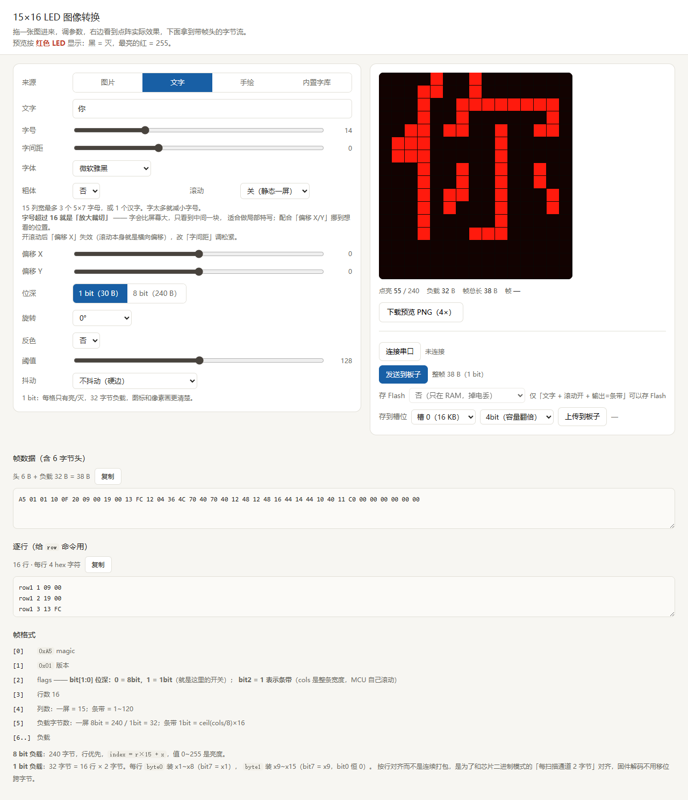
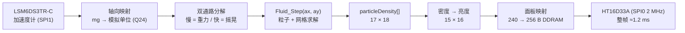
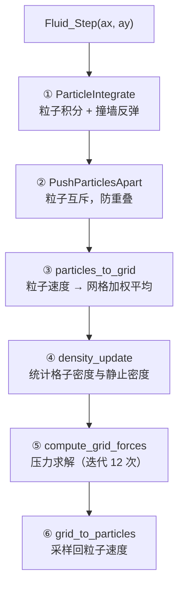

# MSPM0G3507 流体模拟

在 LP-MSPM0G3507 上运行的**实时二维流体模拟**。
把板子倾斜，板载加速度计测出重力方向，流体就顺着重力流向低位，最后静止下来。

算法移植自 CH32V203 上的 Charlieplex LED 点阵项目 `FLIP_LED`，
显示层和定点数学层在本工程中全部重写。

| 项目             | 内容                                                                             |
| ---------------- | -------------------------------------------------------------------------------- |
| 主控             | MSPM0G3507（Cortex-M0+ @ 80 MHz，**无 FPU**；128 KB Flash / 32 KB SRAM）   |
| 封装             | **LQFP-48 (PT)**，订货型号 MSPM0G3507SPTR                                    |
| 显示             | **HT16D33A 16×16 LED 点阵**（SPI0：CLK/DIO/CSB 三线，2 MHz，灰度 256 级）|
| 输入             | **LSM6DS3TR-C**（WHO_AM_I=0x6A，SPI1）；驱动重力 + 摇晃（IMU 不通时自动退回假重力） |
| 算法             | FLIP/PIC 混合流体 + MAC 网格压力投影（Q24 定点 + MATHACL 硬件除法）              |
| 单帧耗时         | 物理 ≈20.3 ms + 推屏 ≈1.2 ms ≈ **21.5 ms/帧**                            |
| 实测占用         | Flash **22.4 KB** / 128 KB，SRAM **22.3 KB** / 32 KB                     |


## 文档导航

| 文档 | 内容 |
|---|---|
| **本文** | 概览、流体算法、定点数学、性能优化、接线、构建、已知限制 |
| [docs/COMMANDS.md](docs/COMMANDS.md) | 串口命令表（40+ 条）、亮度标定、gamma 与边缘映射、判读 |
| [docs/SCENE.md](docs/SCENE.md) | 场景框架、静态图 / 文字滚动、点阵字库、三条设计约束 |
| [docs/BRAKE.md](docs/BRAKE.md) | 刹车高亮：轴选择、基线、陀螺门控、误触发分析（**当前关闭**）|
| [docs/HARDWARE.md](docs/HARDWARE.md) | MATHACL 硬件除法、面板映射推导、LQFP-48 封装 |
| [docs/TUNING.md](docs/TUNING.md) | 可调参数速查、加速度计轴向标定、显示方向 |
## 上位机

`pc/index.html` 是一个**零依赖的单文件网页**：图片 / 文字 / 手绘 → 15×16 帧数据，
再通过 Web Serial 直接推到板子。双击就能用，不用装任何东西，也不需要联网。



四个来源里，图片 / 文字 / 手绘发的是**整帧位图**；「内置字库」只发一条
`text 你好世界` 这样的文本命令，字形由 MCU 自己的 12×12 字库现场渲染
——所以它能跟着重力转 90°/180°。

用法和已知限制见 [pc/README.md](pc/README.md)。

## 显示布局

面板是 **16 列 × 15 行（240 颗）**，流体网格是 **15 列 × 16 行**，两者是**转置关系**，
由 `led_matrix.h` 的 `LED_ORIENT_SWAP_XY / FLIP_X / FLIP_Y` 处理
（方向和机械安装有关，看综合演示的图案段调）。

灰度模式下每格是 **1 字节亮度（0~255）**，不是简单的亮/灭：液体内核亮、表层暗，
所以液面看起来是柔的。想退回二值显示，把 `ht16d33a.h` 的
`HT16D33A_USE_BINARY_MODE` 置 1（`fluid_demo.c` 里保留了一整套阈值 + 滞回实现）。

## 数据流



整条链路是**单线程超级循环**：`main()` 初始化完成后进入 `FluidDemo_Run()` 的
`for(;;)`，中间只靠一个 SysTick 中断（每 1 ms 给 `tick_ms++`）提供时间基准，
另有一个 TIMA0 的 5 ms 中断跑按键扫描与一键开关机。
LED 点阵和 SPI 都是轮询（阻塞）访问，没有任何“等中断”环节。

## 流体算法

### 为什么用 FLIP/PIC 混合

纯粒子法（SPH）在 170 个粒子这种极稀疏的规模下会散成一团；纯网格法（欧拉）
会把流体抹糊。这里用的是**混合**方案：

- **粒子**负责对流：每个粒子独立运动，液面不会糊
- **网格**负责不可压缩：压力求解保证速度场无散度，液体才有“水”的感觉
- 每步结束时把网格速度按比例**混合回**粒子（FLIP/PIC 的区别就在这个比例）

### 一个时间步的六个阶段



各阶段在 80 MHz 下的实测耗时（**MATHACL 优化之前**的基线）：

| 阶段                      | 作用                  | 耗时              | 含`_IQdiv` |
| ------------------------- | --------------------- | ----------------- | ------------ |
| ①`ParticleIntegrate`   | 粒子积分 + 撞墙       | 0.25 ms           | —           |
| ②`PushParticlesApart`  | 粒子互斥（1 次迭代）  | 8.2 ms            | ✓           |
| ③`particles_to_grid`   | 粒子 → 网格          | 4.4 ms            | ✓           |
| ④`density_update`      | 密度统计              | 0.6 ms            | ✓           |
| ⑤`compute_grid_forces` | 压力求解（12 次迭代） | 6.5 ms            | —           |
| ⑥`grid_to_particles`   | 网格 → 粒子          | 8.0 ms            | ✓           |
|                           | **合计**        | **28.2 ms** |              |

> 换成 MATHACL 硬件除法后**总耗时降到约 20.3 ms**（省 7.9 ms，−28%）。
> 按上表“含 `_IQdiv`”那一列判断，省下来的时间落在 ②③⑥ 三个阶段。
> 当前 HUD 只显示总耗时 `SIM`，想看分阶段需要把计时代码加回去。

### 网格与粒子参数

| 参数            | 值                                                        | 位置             |
| --------------- | --------------------------------------------------------- | ---------------- |
| 网格            | 17 × 18（外圈为 SOLID 边界，内部可视 15 × 16 = 240 格） | `fluid.h`      |
| 粒子数          | 170                                                       | `fluid.h`      |
| 粒子半径 / 间距 | 0.017 / 0.05                                              | `fluid.h`      |
| 时间步长`dt`  | 0.032 s                                                   | `fluid_demo.c` |
| 压力迭代次数    | 12                                                        | `fluid_demo.c` |
| 撞墙弹性        | -0.9                                                      | `fluid.h`      |

> `dt = 0.032` 而一帧（物理 ≈20.3 ms + 推屏 ≈1.2 ms）只要 21.5 ms，
> 所以仿真速度是实时的 **1.49 倍** —— 看起来比现实快一点。
> 想要正好等于实时，把 `dt` 改成约 **0.0215**。
> `dt` 只出现在 `ParticleIntegrate` 的 4 次乘法里，所以改变它对总耗时的
> 影响几乎为零（压力投影是在速度场上做的，与 `dt` 无关）。

## 定点数学：为什么要自己写

原 CH32 工程用的是 WCH 的 `libIQMath_RV32.a`（Q24 定点库），但那是
**RISC-V 预编译二进制，在 ARM 上无法链接**。所以 `hardware/fluid_iqmath.h`
按相同的 Q24 语义重写了一份，只依赖标准库：

| 宏              | 实现                                                                 |
| --------------- | -------------------------------------------------------------------- |
| `_IQ(x)`      | 编译期把浮点常量折成 Q24，不产生运行时代码                           |
| `_IQmpy(a,b)` | 内联的 4 次 16×16→64 位乘法，避免调用库函数`__aeabi_lmul`        |
| `_IQdiv(a,b)` | **MATHACL 硬件除法器**（写 4 个寄存器，约 10~20 周期；见下文） |
| `_IQsqrt(a)`  | 32 次逐位 shift-add（也可以换 MATHACL，但全工程只用了 1 次，未换）   |

Cortex-M0+ 没有 FPU，也没有单指令 32×32 乘法，所以 Q24 乘法的开销必须认真
对待 —— 详见下一节。

## 性能优化

物理计算侧一共做了三步，每步都有实测数据支撑（80 MHz、`-O2`）：

| # | 改动 | 效果 | 依据 |
| - | --- | --- | --- |
| 1 | 热点函数搬进 SRAM（`.TI.ramfunc`）+ 乘法内联 | 50.7 ms → 31.6 ms（1.60×）| 含除法的阶段提升小、不含的提升大（INT 2.5×、DEN 3.2×）|
| 2 | `_IQdiv` 从 64 位整数除法改为软浮点除法 | 31.6 ms → 28.2 ms（−11%）| INT/DEN/PRS 不含除法，耗时不变；SEP/TOG/FRG 掉了 10~20% |
| 3 | `_IQdiv` 改用 **MATHACL 硬件除法器** | 28.2 ms → **≈20.3 ms**（−28%）| 单次除法从 ~700 周期降到 ~20 周期 |

合计：**50.7 ms → 20.3 ms（2.5 倍）**。

> 显示侧当年还有两步（OLED 逐字节推屏 → 分页事务 → I2C 1 MHz），
> 把一帧从 42.4 ms 压到 26.3 ms。那套代码已经随 OLED 一起删除，
> 现在的 LED 点阵整帧只要 1.2 ms —— 但**思路是一样的：
> 先把推屏从"逐字节"改成"整块"**。
关键教训：**优化前先测**。一开始我以为瓶颈在压力求解（迭代 12 次听起来很贵），
但实测四个迭代次数（12/8/4/1）的耗时符合 `SIM ≈ 406 + 8.6 × GI`，
说明压力求解只占约 10 ms（4%），固定开销占了 96%。

另一条教训：**用“改动前后的差值”定位瓶颈，比读汇编数指令可靠**。
第 3、4 两步都是只换除法实现，通过对比“含除法 / 不含除法”两类阶段的
耗时变化，就能反推出除法到底占了多长时间。

MATHACL 的开启步骤、寄存器调用序列、验证方法，以及“`_IQmpy` 为什么故意没换”，
见 [docs/HARDWARE.md](docs/HARDWARE.md)。

## 调试观测（dbg）

OLED 已删除，所有观测量都走 `hardware/debug.h` 的全局 `dbg` 结构体 ——
没有屏，参数只能这样看：在 CCS 的 Expressions 里展开 `dbg`，或把它加进 Watch 窗口。

| 字段 | 含义 |
| --- | --- |
| `dbg.fluid.ax10` / `ay10` | **实际送入流体算法**的值（模拟单位 ×10）。正着放时应为 `(0, +98)` |
| `dbg.fluid.ax_slow10` / `ay_slow10` | 慢通路（重力 / 倾角）分量 |
| `dbg.fluid.ax_fast10` / `ay_fast10` | 快通路（摇晃 / 惯性）分量，已含增益 |
| `dbg.fluid.shake_pk10` | 窗口内摇晃峰值（静止 ≈0，摇起来几百）|
| `dbg.fluid.sim_ms_x10` | 单步物理平均耗时 ×10（`203` = 20.3 ms）|
| `dbg.fluid.fps` / `frames` | 帧率 / 累计物理步数 |
| `dbg.fluid.dens_max` / `rest_dens` | 窗口内最大密度 ×1000 / 静止密度。**`rest_dens` 变负就是 int32 溢出**，见 `fluid.h` 里 `NumberOfParticles` 的注释 |
| `dbg.fluid.imu_ok` / `imu_use` | IMU 初始化返回码 / 本帧是否真的用了 IMU |
| `dbg.bat.mv` / `low_cnt` / `err` | 电池电压(mV) / 连续低电次数 / 转换超时次数 |
| `dbg.key.*` / `dbg.pwr.*` | 三路按键状态 / 一键开关机状态机 |

## 显示刷新

每个时间步把 `particleDensity[]` 按密度映射成亮度写进 `s_frame[256]`（DDRAM 顺序），
然后一次整帧推送：

| 项目 | 值 |
| --- | --- |
| 数据量 | 256 字节（16 列 × 15 行，每点 1 字节亮度）|
| 接口 | SPI0 @ 2 MHz，`HT16D33A_WriteRam()` 分 8 个 burst |
| 整帧耗时 | **≈1.2 ms**（21.5 ms 一帧里的 5.6%）|

> 二值模式下 DDRAM 只有 32 字节（1 bit/点），推屏更快，但液面会变成硬边。

## 硬件接线

| 功能 | 引脚 |
| --- | --- |
| IMU SPI1：SCLK / PICO(MOSI) / POCI(MISO) / CS | **PA17 / PA18 / PA16 / PA15** |
| LED 点阵 SPI0：SCLK / DIO(MOSI) / CSB | **PA6 / PA5 / PA4** |
| 指示 LED（当前无应用引用，留着备用）| PB8 |
| 一键开关机 `PWR_HOLD`（电源自锁）| PA22 |
| USER1 / USER3 | PA25 / PA23 |
| USER2（**本板未装按键，引脚悬空**）| PA24（已开内部上拉）|
| 电池采样 ADC0 通道 0 | PA27 |
| 预留 UART_0（UART1）TX / RX | PB6 / PB7 |
| SWD 调试 | PA19 / PA20 |
| （空闲）I2C1：SCL / SDA | PB2 / PB3 |

`.syscfg` 里的模块：`SYSCTL`、`MATHACL`、`SPI1`（IMU）、`SPI0`（LED 驱动）、
`UART1`（预留串口）、`ADC0`（电池采样）、`TIMA0`（**5 ms 按键节拍**）、
`I2C1`（**已无驱动，仅剩实例**），GPIO 组 5 个：`GPIO_LSM6DS3TRC`（IMU 片选）、
`LED`（指示灯）、`GPIO_LED_DRV`（LED 驱动 CSB）、`GPIO_PWR`（电源自锁 PA22）、
`GPIO_USERKEY`（USER1/2/3 = PA25/24/23），以及 `Board`（SWD）。

**所有外设和引脚都已显式 `$assign`**，所以重新生成、换封装时自动求解器
**不会**再改动引脚分布。

> ⚠️ `.syscfg` 里的 `//` 注释会在你用 **SysConfig 图形界面保存时被抹掉**
> （工具会重写整个文件）。想留注释就写在 README 里。
>
> ⚠️ `I2C1`（PB2/PB3）现在没有任何驱动使用 —— OLED 那套代码已全部删除。
> 想彻底清掉得在 SysConfig 里删掉该模块再重新生成。

### 一键开关机与 3 路按键

| 功能                        | 引脚                              | 上拉               |
| --------------------------- | --------------------------------- | ------------------ |
| 电源自锁 `PWR_HOLD`         | PA22（输出，上电即为高）           | —                  |
| USER1（开关机 + 切下一个场景）| PA25                             | MCU **内部**上拉   |
| USER2（**本板没装按键**）    | PA24                              | MCU **内部**上拉   |
| USER3（切上一个场景）        | PA23                              | 板上**外部**上拉   |

> ⚠️ **USER2 在本板上是悬空的**：既没装按键，原本 syscfg 里也是 `NONE`（既没内部
> 上拉、也没外部上拉）。悬空输入经过去抖器会被随机承认成"按下"，表现为功能
> 自己触发 —— 所以已经给它开了**内部上拉**，并且**没有任何功能绑在它上面**。
> 以后要加第三个按键，直接焊到 GND 就能用（代码里 `KEY_USER2` 是现成的）。

两个键都是**按下 = 低电平**。开机自锁由 SysConfig 的 `initialValue = SET` 在
`SYSCFG_DL_GPIO_init()` 里完成（先 `setPins` 再 `enableOutput`），**不需要开机代码**。

- **开机**：按键按下 → 硬件给电 → MCU 上电 → 自锁。
  ⚠ 此刻按键**还按着**、USER1 读到低，所以状态机必须**先等它松开**才允许关机
  —— 少了这一步的症状就是"一上电立刻关机，永远开不了机"。
- **关机**：就绪后 **长按 USER1 两秒**（`POWER_OFF_HOLD_MS`）→ 拉低 PA22 → 松手断电。

按键扫描与去抖在 [hardware/key.c](hardware/key.c)（20 ms 去抖），开关机状态机在
[hardware/power.c](hardware/power.c)，两者都由 **TIMA0 的 5 ms 中断**每拍驱动
（`main()` 里 `NVIC_EnableIRQ(TIMER_0_INST_INT_IRQN)`）。放中断里而不是主循环，
是为了主循环一旦卡死也还能关机 —— 否则 PA22 永远放不掉，用户只能拔电池。

> ⚠️ **TIMA0 是 16 位计数器**：5 ms 在 40 MHz 下要 200000 拍、放不下，
> 所以 `TIMER1.timerClkDiv` 必须同时从 2 改成 **8**（40 MHz → 10 MHz，LOAD = 49999）。
> 连带影响：`DBG_TicksToUs()` 的除数从 40 改成 **10**（1 拍 25 ns → 100 ns），
> 否则 `dbg.perf.read_us` 会显示成真实值的 1/4。

> UART_0 的初始化与中断处理函数都保留着，但 **NVIC 是关闭的** ——
> 在 `gpio_toggle_output.c` 的 `main()` 里加 `NVIC_EnableIRQ(UART_0_INST_INT_IRQN)`
> 就能用（外设侧的中断使能 `SYSCFG_DL_init()` 里已经做好了）。
> TIMER_0 的 NVIC 是**打开**的，它跑 5 ms 按键节拍。


## 目录结构

| 路径                                      | 内容                                                            |
| ----------------------------------------- | --------------------------------------------------------------- |
| `gpio_toggle_output.c`                  | `main`、SysTick 节拍、三个预留的中断处理函数                  |
| `gpio_toggle_output.syscfg`             | 外设与引脚配置（SysConfig 图形化）                              |
| `hardware/fluid.c` / `fluid.h`        | **流体算法本体**，零外设依赖，可原样拿到 PC 上编译        |
| `hardware/fluid_iqmath.h`               | Q24 定点数学库                                                  |
| `hardware/fluid_demo.c` / `.h`        | 胶水层：IMU 重力 + 摇晃 → 算法 → LED 点阵（IMU 不可用时退回假重力） |
| `hardware/clock.c` / `.h`             | `tick_ms` 1 ms 节拍、SysTick 初始化                           |
| `hardware/lsm6ds3trc.c` / `.h`        | LSM6DS3TR-C（WHO_AM_I=0x6A）最简 SPI 驱动，读六轴 + 温度      |
| `hardware/battery.c` / `.h`           | 电池采样（ADC0/PA27）+ 运行期低电保护（熄屏安静窗口 → 连续 3 次低电关机）|
| `hardware/debug.c` / `.h`             | 观测量结构体 `dbg` + 时间打点/窗口统计 + HardFault 现场捕获    |
| `hardware/imu_selftest.c` / `.h`      | 可选：陀螺仪读取自检（**无屏**，观测量全在 `dbg`），默认 0 |
| `hardware/key.c` / `.h`               | 3 路按键扫描 + 20 ms 去抖（TIMA0 5 ms 中断里跑）                |
| `hardware/power.c` / `.h`             | 电源自锁（PA22）+ 一键开关机（长按 2 s 关机）                    |
| `hardware/ht16d33a.c` / `.h`          | HT16D33A 16×16 LED 点阵驱动（SPI0：CLK/DIO/CSB 三线）           |
| `hardware/led_matrix.c` / `.h`        | 映射层：面板 (列,行) → 芯片 (扫描/数据通道) → 显示 RAM 位        |
| `hardware/led_show.c` / `.h`          | LED 综合演示序列（全亮→全黑→游走→图案）+ 串口可调用的接口，**当前 = 0** |
| `hardware/app.c` / `.h`               | **场景框架 + 输入层**：IMU 双通路、按键、场景切换、主循环 |
| `hardware/scenes.h`                   | 所有场景的入口声明（加场景时改这里）|
| `hardware/scene_still.c`              | **场景 1：静态图**（px / fill / ramp，亮度标定用）|
| `hardware/scene_text.c`               | **场景 2：文字滚动**（点阵字库 → 条带 → 横向滚动）|
| `hardware/scene_frame.c`              | **场景 3：上位机直显 + 图片/动图槽**（RAM 直显 + Flash 槽）|
| `hardware/flash_store.c`              | 主 Flash 数据区读写（8 字节整字 + 关中断）|
| `hardware/glyph_store.c`              | 自定义滚动字形的 Flash 持久化（底层走 `flash_store`）|
| `hardware/wqy12_common.h`             | 12×12 中文点阵字库（599 字，19.6 KB Flash）|
| `pc/index.html`                       | **上位机**：零依赖单文件网页，图片/文字/手绘 → 帧数据 + Web Serial |
| `pc/font/`                            | 字库工具链：BDF → 点阵 .bin / .h 的生成与裁剪脚本 |
| `docs/`                               | README 用图 + 专题文档（命令表 / 刹车 / 场景 / 硬件 / 调参）|
| `hardware/brake.c` / `.h`             | **刹车高亮**：加速度计判定 + 全屏满亮 + 可替换显示接口 |
| `hardware/vcmd.c` / `.h`              | **串口下行命令**：RX DMA + 文本解析 → 命令邮箱 |
| `hardware/vofa.c` / `.h`              | **串口上行遥测**：FireWater 帧 + TX DMA（忙就丢帧）|
| `Debug/`                                | CCS 生成的构建脚本（`makefile`、`subdir_vars.mk` 等）与产物 |

几个演示/自检程序都由头文件里的 `*_ENABLE` 开关控制：为 0 时它们的函数
无人调用，会被链接器段回收丢掉，**不占任何 Flash**。
`imu_selftest` 默认 0；`led_show` 当前也是 **0** —— 让位给流体模拟，
`main()` 里跑的是 [hardware/fluid_demo.c](hardware/fluid_demo.c)。
LED 演示 / IMU 自检在 `main()` 里用 `#if/#elif` 互斥，优先级
**LED > IMU > 流体**；想跑哪个就把它置 1、并把优先级更高的那个关掉。

## 编译与烧录

环境：

- Code Composer Studio 20.5.0
- TI Arm Clang `ti-cgt-armllvm_4.0.4.LTS`（`C:/ti/ccs2050/ccs/tools/compiler/`）
- MSPM0 SDK `2.10.00.04`（`C:/ti/mspm0_sdk_2_10_00_04`）

命令行编译：

```powershell
C:\ti\ccs2050\ccs\utils\bin\gmake.exe -C "Debug" -j 16 all
```

或在 CCS 里直接 Build。产物是
`Debug/gpio_toggle_output_LP_MSPM0G3507_nortos_ticlang.out`。

烧录：在 CCS 里 Debug / Flash，或把 `.out` 拖进 UniFlash。

> `.vscode/tasks.json` 里的“编译 MSPM0 工程”任务已经指向 `ccs2050`，
> 在 VS Code 里 `Ctrl+Shift+B` 就能编。

## 开发注意事项

几个踩过的坑，改代码前先看一眼：

1. **gmake 不跟踪头文件依赖**。`subdir_rules.mk` 只生成 `.d_raw`，没有转成 `.d`
   的步骤，所以改了 `.h` 之后 make 可能不会重编受影响的 `.c`。
   **改完头文件记得手动删掉对应的 `.o` 再编译。**
2. **增删 `.c` 文件要改 4 个地方**：

   - `Debug/hardware/subdir_vars.mk` 的 `C_SRCS` / `C_DEPS` / `OBJS`
   - 同文件的 `C_SRCS__QUOTED` / `C_DEPS__QUOTED` / `OBJS__QUOTED`
   - `Debug/makefile` 的 `ORDERED_OBJS`（**链接实际用的是这个**）
   - `Debug/makefile` 的 `clean:` 规则
3. **`Debug/ti_msp_dl_config.c/.h` 是自动生成的，不要手改**。
   `Debug/subdir_rules.mk` 里 `ti_msp_dl_config.c/h`、`device_linker.cmd` 都依赖
   `../gpio_toggle_output.syscfg`，并会调用 `sysconfig_cli.bat` 重新生成。
   也就是**每次构建**都会跑一遍 SysConfig（日志里的
   `Writing ...ti_msp_dl_config.c...`）。所以改完 `.syscfg` 直接 `make` 就行，
   不需要在 CCS 里再手动保存一次；反过来，手改生成的文件一定会被覆盖。
4. **80 MHz 时钟与 SysConfig 时钟树互斥**：`.syscfg` 里必须
   `clockTreeEn = false` 且不勾选 `forceDefaultClkConfig`，否则 SysConfig 会
   忽略 `SYSPLL_Pdiv/Qdiv/CLK2XDiv` 这些字段。时钟分频规则：
   MCLK 域外设（UART/SPI/I2C/TIMA0）是 **80 MHz**，
   ULPCLK 域（TIMG0/6/7/8/12、ADC12）是 **40 MHz**。
5. **git 的 `core.autocrlf=true`**：`git add` 时会出现一堆
   `LF will be replaced by CRLF` 警告，无害。

## 已知限制与后续可做

- **当前阶段：流体模拟 + 灰度渲染 + 电池低电保护已跑通**。
  `hardware/lsm6ds3trc.c` 只做寄存器读写与原始值换算，**不做姿态解算**；
  应用只取 3 轴加速度计里的 2 轴。
- **串口调试通道已实现**（`vcmd.c` / `vofa.c`，收发全 DMA），命令表见
  [docs/COMMANDS.md](docs/COMMANDS.md)；
  设计背景见 [串口与画面功能设计.md](串口与画面功能设计.md)。
- **自定义画面已实现**（`scene_frame.c` + `flash_store.c`）：上位机上传、Flash 分槽、按帧播放；
  方案见 [自定义画面方案.md](自定义画面方案.md)。
- **协作流程**见 [GIT_WORKFLOW.md](GIT_WORKFLOW.md)（分支模型 / rebase / 撤销速查）；
  **每天怎么开工收工、`dev` 怎么合进 `main`** 见 [GIT_DAILY_WORKFLOW.md](GIT_DAILY_WORKFLOW.md)。
- 推屏 1.2 ms 期间 CPU 空转（SPI 轮询）。改 DMA 能省下来，但只占一帧的 5.6%，
  **收益已经不大** —— 优先级低于上面的串口 / 画面。
- 每帧都推全部 256 字节。改成**只推变化的 burst** 能省一部分，液体静止时几乎全免。
- 灰度（256 级）已经实现，不需要再上 Bayer 抖动。
- 粒子数 170 仍偏少，液面有颗粒感。加粒子能变细腻，但 ②③⑥ 三个阶段与粒子数
  成正比，物理耗时会线性上升（`fluid.h` 里记了"加粒子就塌缩"那个 int32 溢出的坑，
  加之前先读那段注释）。
- 物理耗时的大头是 ② `PushParticlesApart` 和 ⑥ `grid_to_particles`
  （都是粒子 → 网格的邻域遍历）。可以试试把邻域查询用的空间换到 SRAM。
- **6 轴里的陀螺仪完全没用上** —— 驱动读了 6 轴，进算法的只有 2 轴加速度。
  陀螺可以用来做两件事：
  - **互补滤波**：重力向量 + 角速度积分，得到更干净的重力估计，
    顺带抑制“快速平移被误判成倾斜”
  - **涡旋注入**：拿绕屏幕法线的角速度给流体加切向速度，
    做成“转手腕液体打旋”的效果
- `hardware/IMU660RB/`（LSM6DSR + Fusion 姿态库）曾作为参考留在仓库里，
  但它从未被 include、也未链接进固件，公开前已经移除。